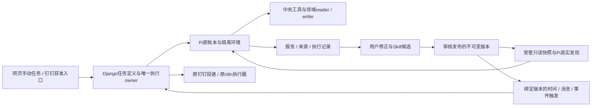

# AI 助理任务、Skill与自动工作流施工方案

版本：2026-10-28-v2；沿用v1已审源码事实。隔离分支已合入本机main `18dc5006`，远端main在本次修订时仍为 `72d07ad7`；相关AI源码与根规范未变化。v1方案提交为 `71393177`，本版替换其实施优先级，不将未实现设计表述为现有能力。

本次按用户“调整施工”的新方向修订方案：先用最小通用能力完成实际任务，取得报告、可观察执行记录与用户明确修正，再提炼可复用Skill，最后将获准Skill接入定时或事件工作流。当前只调整文档，未开始业务代码、真实模型调用、外发或生产操作。拟定接口、表、文件均为设计，开发前核最新main；不等待全部平台和工具建齐才交付首个案例。

执行依据为根 [AGENTS.md](../../AGENTS.md)、[开发与交付](../规范/开发与交付.md)、[任务模型分工](../规范/任务模型分工.md)、[系统架构](../规范/系统架构.md)、[前端与性能](../规范/前端与性能.md)、[安全与 AI 工具](../规范/安全与AI工具.md)、[数据存储与迁移](../规范/数据存储与迁移.md)、[验证与发布](../规范/验证与发布.md)。根入口规定的“合并、制品准备、发布分别取得当次授权”优先于专题中遗留的连续交付表述。方案通过不构成实施、合并、准备或上线授权。

## 1. 目标、范围与实施原则

主线是“最小底座→手动任务产出→用户修正→Skill候选→审核发布并真正加载→受授权自动执行→结果反馈”。经营日报、推广诊断、库存补货贯穿全程；每个案例独立可交付，后续能力由真实任务缺口触发。报告回答某次问题，Skill保存可复用方法，调度定义决定何时、以谁的权限、对哪个对象运行，三者不混成一份提示词。

继续使用现有 React 页面、薄 Worker、Django AI 域、中央工具注册表及独立 Pi Runner，不重建 Agent、模型管理、记忆、Skills 或业务写入系统。保留用户配置的长上下文、高输出、长任务时限与自由参数；仅按供应商真实支持、参数关系、权限和资源边界拒绝无效输入，不以“省成本”为由静默降档、缩短任务或截断答案。

最小首批包含一个已授权店铺的必要工具接线、报告/来源/执行记录、用户修正入口，以及Skill候选管理、发布与Pi受管加载闭环。连接器和跨渠道任务调度是核心工程包，紧接首批实施；先钉钉及已有系统数据，逐任务增加时间、消息、事件和条件触发。较大附件、视觉、公开研究、知识向量化、Responses及更多平台按案例解锁，不阻塞无此依赖的日报。语音、动态登录浏览器和任意插件加载仍不在默认范围。

“马上做真实任务”指相应代码交付并获采用后，由用户发起或明确授权案例任务，系统使用真实数据产生报告和执行证据；不是本轮AI擅自调用生产或进行功能验收。人工案例不等待定时器，定时器不等待所有连接器，连接器也不以全量聊天读取为目标。

新增资源预算是可配置执行策略，不能混同模型产品上限。暂停、取消、关闭、终态、结果未知分别保留；已发出的模型请求、业务写入和消息投递结果未知时不自动重放。本文不承诺工期、百分比收益或当前生产已具备某项能力。

## 2. 现状事实与具体使用场景

| 已有事实及证据 | 当前接缝 | 本次处理 |
| --- | --- | --- |
| [Pi 运行说明](../技术专题/AI助手/pi-agent-runtime.md)及 [pi_native.py](../../backend/ai_assistant/pi_native.py)已有计划、问卷、子代理、消息、等待和取消 | 源码存在不证明结构、Runner、镜像及旧环境均已采用 | 复用；发布材料分别声明各层状态 |
| [pi_workspace.py](../../backend/ai_assistant/pi_workspace.py)已有终端、文件、依赖安装、插话、会话树和手动压缩 | 不能把现有终端和 Skills 重新列为缺失 | 增量接线，保留现有控制身份 |
| [report_library.py](../../backend/ai_assistant/report_library.py)已有三类文字skills、templates、pipelines，AiLibraryRevision不可变版本、expectedVersion CAS、guidance及pin快照 | 普通Chat/DAG可用文字指导，尚不是产品库版本到Pi原生Skill的受管加载桥 | 复用管理、模板和版本语义，新增候选来源、发布包及加载状态 |
| [资源库手册](../使用手册/AI助手/ai-report-library.md)已有本系统JSON frontmatter导入导出 | 不支持任意YAML、脚本和目录；原库128KiB、单类数量及正文限制不适合整包文件 | 元数据与有界资源包分层，不暴力扩大原全局JSON |
| [skills.py](../../backend/pi_runner/skills.py)是镜像构建期manifest生成；[native-capabilities.mjs](../../containers/pi-agent/native-capabilities.mjs)只发现固定镜像根 | 数据库新增Skill或workspace写SKILL.md不能自然生效 | 新增受管只读快照、协议协商和真实Pi发现路径 |
| [dingtalk_schedules.py](../../backend/ai_assistant/dingtalk_schedules.py)及[独立调度命令](../../backend/ai_assistant/management/commands/dingtalk_schedule.py)已有日/周/月任务与投递账本 | 不是通用Skill任务定义；有既定漏窗跳过及unknown不重发规则 | 接入兼容适配与统一任务视图，不另起重复执行者 |
| [tool-registry.ts](../../lib/ai/tool-registry.ts)有知识、记忆、推广诊断和新版网店工具；[pi_gateway.py](../../backend/ai_assistant/pi_gateway.py)按 `pi_agent` 筛选 | 部分工具未开放该 surface；只增加 schema 不能使调用全链路生效 | 逐项补 surface、handler、后端准入及 scope |
| [gateway-extension.mjs](../../containers/pi-agent/gateway-extension.mjs)只提取文本块；Pi 网关要求文本 content | 附件可保存、脚本可读取，不代表模型可看图或 PDF 页面 | 引入受控内容块与视觉投递 |
| [pi_service.py](../../backend/ai_assistant/pi_service.py)输入 512 KiB、输出 8 MiB；[pi_models.py](../../backend/ai_assistant/pi_models.py)保存文件字节 | 大工作簿/PDF容易在上传前被拒；链路还有独立请求边界 | 分片上传、流式下载及分片入容器 |
| [pi_research.py](../../backend/ai_assistant/pi_research.py)已有公网 GET；[工作区界面](../../app/ai-pi-workspace.tsx)由用户填写并引用研究结果 | 模型工具目录中没有完整自主研究入口 | 复用读取器并接中央注册表 |
| [provider.py](../../backend/ai_assistant/provider.py)已有 Chat Completions/Messages；[model_capabilities.py](../../backend/ai_assistant/model_capabilities.py)已有参数能力处理 | Pi 未把模型文本增量接到用户；没有原生 Responses 路由 | 分批增量实现，维持原适配器 |
| [memory.py](../../backend/ai_assistant/memory.py)有确认、scope、CAS和审计；[knowledge.py](../../backend/ai_assistant/knowledge.py)有版本化词法检索 | 记忆整句包含匹配较弱，知识只扫描最新100条候选 | 先接通，再改索引与召回 |
| [pi_exports.py](../../backend/ai_assistant/pi_exports.py)保留截止日、版本、SHA及完整性 | `live_per_page` 明确不等于跨页原子快照 | 引用保留一致性等级，不伪造完整快照 |

| 贯穿案例 | 首次手动报告与用户修正 | 可复用Skill与自动化方向 |
| --- | --- | --- |
| 经营日报 | 一个明确平台/店铺、截至昨天的有效数据；报告列覆盖、变化、异常与待办。用户纠正指标口径、关注对象或章节 | 把店铺、业务日期、对比窗和异常阈值参数化；依赖源数据就绪后按授权时间投递钉钉 |
| 推广诊断 | 复用现有诊断/insights，区分平台归因ROI、ERP销售与利润；用户纠正归因或筛选条件 | 固定取数/核对/证据/输出步骤；支持手动、授权消息命令或数据版本事件，首版不自动改出价/预算 |
| 库存补货 | 读取正式库存、销量、在途及建议，列出仓别/快照和缺口；用户修改补货周期或业务约束 | 保存参数化方法；条件触发只生成建议/获准草稿，不自动采购或通知供应商。不能证明单店归属时使用单独获准库存scope |

同一案例可先完成报告和修正，再单独发布Skill，随后单独启用调度。某次“ROI低于某值就停投”的结论不能未经用户确认变成所有店铺的永久规则；缺数、假设和临时异常不能被提炼器洗成确定业务知识。

## 3. 复用架构与分期依赖



Worker不承担网页抓取、长期解析或新领域业务。容器不获得生产数据库、模型密钥、浏览器 Cookie、宿主目录或网络；模型调用、数据查询与公开研究仍经容器外受控入口。文件进入模型不新增业务权限，网页文字与知识条目都是低信任数据。

| 新阶段 | 范围与独立交付单位 | 依赖、相对复杂度 |
| --- | --- | --- |
| P0 最小通用底座 | 一店必要取数、来源和可观察记录、报告下载、修正入口 | 中；可先交付手动日报，不依赖新附件/研究/Responses |
| P1 案例与Skill闭环 | 三案例按需推进；候选生成、管理、审核发布、受管加载、再次手动复用 | 中高；关键路径是可追溯案例→不可变Skill包→真实发现，不是全平台工具集 |
| P2 自动任务与连接器 | 钉钉接入、统一定义、时间/消息/事件/条件触发、数据依赖和投递；原n8n协调 | 高；依赖P1固定版本和明确长期授权，先一个任务一种触发，逐项扩展 |
| P3 按任务解锁能力 | 分片/视觉、公开研究、知识质量、上下文增强、Responses及更多平台 | 各自中至高；仅被案例需要的模块前移，不要求整包实施 |

| v1工作包 | v2归属与变化 |
| --- | --- |
| A1工具/记忆接通 | P0只做当前案例所需工具，其余随P1案例扩展 |
| A2附件/视觉、A3研究 | P3按真实材料和研究任务解锁；沿用原具体契约 |
| B1流式/上下文 | 基本阶段记录进P0；真实文本delta与压缩按需求进P3，不用等待它才交报告 |
| B2知识/记忆质量 | 原记忆接通保留P0，索引和向量留P3；Skill不代替知识库 |
| C1 Responses | P3可选provider能力，不作为核心闭环前置 |
| C2技能/连接器/业务 | Skill管理和发布加载前置P1，连接器/跨渠道调度升级为P2核心包；成本汇总按需 |

每阶段在独立 `codex/*` worktree开发；一个负责人集成，关键权限、状态和存储契约由独立审查上下文核对。审查与实现均遵守发布分工，不通过方案额外引入 AI 功能测试或业务验收门槛。

## 4. 重排后的开发任务与最小首批

“完成形态”是需交付的代码和材料，不表示本方案已实现。已有路径可直接定位；拟新增路径仅为建议命名，实施时与仓库最新组织方式核对。

| 编号 | 开发动作与完成形态 | 入口 / 拟新增文件 |
| --- | --- | --- |
| P0-01 | 输出案例工具可达矩阵，选一店日报所需集合；核schema/handler/后端准入/单店边界 | [tool-registry.ts](../../lib/ai/tool-registry.ts)、[pi_gateway.py](../../backend/ai_assistant/pi_gateway.py)、pi_selection |
| P0-02 | 接通所需数据和知识/记忆，自动与主动检索共用可信scope | [transport.py](../../backend/ai_assistant/transport.py)；拟 `backend/ai_assistant/pi_context.py` |
| P0-03 | 报告绑定原operation、来源、参数与文件；展示真实阶段和unknown | pi_service/pi_worker；拟 `backend/ai_assistant/pi_sources.py`、`app/ai-source-citations.tsx` |
| P0-04 | 修正卡保存用户明确更正及目标报告版本，区分建议与已确认修正 | 拟 `backend/ai_assistant/task_feedback.py`；复用原报告与工作区 |
| P1-01 | 经营日报先产出，推广/库存按现成能力追加；从报告入口申请生成候选 | report_library、原报告/文件及Pi会话接口 |
| P1-02 | 提炼参数化方法、保留来源清单，生成候选差异与不可执行包 | 拟 `backend/ai_assistant/skill_candidates.py` |
| P1-03 | 复用资源库管理与CAS，新增owner/scope、候选/正式版本、发布/停用/回退关系 | report_library；拟 `skill_packages.py`、`skill_models.py`及页面增量 |
| P1-04 | 实现包manifest/兼容检查/只读快照交付，新增受管loader协议 | [skills.py](../../backend/pi_runner/skills.py)、[protocol.py](../../backend/pi_runner/protocol.py)、native-capabilities；拟 `published_skills.py` |
| P1-05 | pi_service.skills合并获准目录，真实发现/读取/调用回执；缺工具阻止执行 | pi_service/pi_worker/pi_native、原技能选择界面 |
| P1-06 | 发布版本手动复用，冻结输入/模板/helper/版本；变化形成新候选，不覆盖旧运行 | 原guidance/pin语义、Pi操作快照 |
| P2-01 | 连接器登记、同owner渠道身份验证及目标权限，首个钉钉消息入口 | dingtalk/channels；拟 `task_connectors.py` |
| P2-02 | 统一任务定义和不可变版本，Skill/参数/身份/触发/依赖/投递/长期授权绑定 | 拟 `task_definitions.py`、`task_models.py`；复用现有任务界面 |
| P2-03 | 时间/消息/事件/条件触发归一化，唯一occurrence与领取fencing | 拟 `task_dispatch.py`；适配dingtalk_schedules及原Pi账本 |
| P2-04 | 数据就绪等待、漏跑策略、取消/unknown协调、投递账本 | 原n8n状态/导入覆盖、pi_business、dingtalk_transport |
| P2-05 | 旧调度注册为外部拥有任务，防第二调度器重复启动；逐任务启用新工作流 | dingtalk_schedule独立命令、原n8n入口，拟 `task_legacy_adapters.py` |
| P3-01 | 分片上传存储/下载→Django与Runner→产物与handoff全链路 | 拟 `pi_file_models.py`、`pi_file_uploads.py`；pi_views、pi_worker、file-transfer、workspace |
| P3-02 | 隔离解析/图像与PDF内容块/引用；模型能力协商 | 拟 `document-extract.py`、`pi_documents.py`；gateway-extension/provider |
| P3-03 | 模型公开研究工具与可信主题/URL引用准入 | tool-registry；拟 `lib/ai/pi-research-tools.ts`，复用pi_research |
| P3-04 | Pi真实文本delta、上下文预算和安全点压缩、恢复卡 | provider/pi_gateway/pi_workspace及原事件面板 |
| P3-05 | 全库词法索引、记忆候选与可选向量；不将Skill包塞进记忆 | memory/knowledge；拟 `knowledge_index.py` |
| P3-06 | 可选Responses、更多获准平台API、价格与用量汇总 | 拟 `provider_responses.py`及逐连接器适配 |
| 共用交付 | 每个实际涉及结构/镜像的包交付有限recipe、角色/readiness/备份清单及协议绑定 | [tools/pi_native_catalog.py](../../tools/pi_native_catalog.py)等有限升级体系 |

可复用工具清单如下，P0只接当次案例需要的子集，其余随P1扩展；“接通”包含目录、handler、传输及所属后端准入，不等于统一放宽原权限。

| 已有工具名称 | 施工重点 |
| --- | --- |
| `search_system_knowledge`、`search_personal_memory` | 自动召回和模型主动检索共用同一可见性规则，落实下文受信Pi环境绑定 |
| `get_jd_promotion_diagnostic` | 保留原支持店铺、角色、期间与对象证据边界 |
| `get_netshop_insights_context`、`get_netshop_product_insights` | 保留范围、覆盖、快照及分页语义，单店归属由所属reader证明 |
| `get_netshop_promotion_insights`、`get_netshop_promotion_object_detail` | 保留对象权限及原sectionToken，不从列表标识猜明细；逐项配套filter_catalog/bind_arguments |

最小首批交付边界为P0与P1的一个完整日报纵向链：用户手动任务→带来源报告→明确修正→私有候选→获准发布→Pi真实加载→另一日期手动复用。推广和库存模板可随后同包迭代，不要求为首个日报先完成全部接口。现有小文件与8MiB产物足够时直接复用；只有案例被附件边界阻塞才前移P3-01。首批不启用真实定时/消息监听，不绑定未知微信账号，不新建一套n8n任务。

## 5. P1：由实际任务形成可发布、可加载的Skill

### 5.1 六类对象分开，复用原产品资源库

| 对象 | 保存内容、来源与生命周期 |
| --- | --- |
| 报告/产物 | 某次任务、参数和数据版本下的结论及文件；不自动成为规则 |
| 执行记录/用户修正 | 原operation、工具名称及脱敏参数、来源/阶段/文件回执、用户明确更正；不保存隐藏推理、凭据或客户原文 |
| 知识 | 经过确认的稳定指标口径/解释，带来源与版本；仍由知识权限控制 |
| 个人记忆 | owner偏好与稳定背景，沿原确认/scope/CAS；不得承载整份任务脚本 |
| Skill包版本 | 参数schema、步骤、工具/helper依赖、报告模板引用、注意事项和来源；提供方法，不提供权限 |
| 自动任务定义 | 绑定Skill精确版本、执行身份、参数、触发、就绪依赖和投递对象；只有启用且授权有效才运行 |

现有 [report_library.py](../../backend/ai_assistant/report_library.py) 与 [report_models.py](../../backend/ai_assistant/report_models.py) 已提供AiLibraryRevision、AiExecutionGuidance、三类文字Skill、模板、流水线、CAS和固定指导快照。新管理入口复用这些页面与语义；原Chat/DAG的guidance/pin继续工作，不把现有文字资源全迁成新执行器。新增SkillPackage/Revision/Candidate及关联表存owner、scope、依赖与文件manifest，目录可引用旧libraryRevision/itemId，资源字节独立有界保存。原128KiB库总量、24技能及正文2000字符等边界保持，不将全部文件塞进全局config_json。

旧库JSON frontmatter导入导出继续只解释原格式。转换到Pi包必须显式生成候选并审阅；普通导入不等于Pi发布。首版owner只能为自身获准案例提出候选；发布沿现有无范围管理员权限，分享/跨owner使用需显式授权，不创造绕过固定应用角色的“技能管理员”。私有包不会因发布进入所有用户的默认发现目录。

### 5.2 候选提炼、审核和版本生命周期

提炼入口绑定一个或多个明确选中的已结束任务及报告版本，另外引用用户确认的feedbackId；执行失败/unknown可作失败经验引用，但不得当成功方法。可观察记录仅含完成了什么、用了哪些工具与来源、哪些缺口未解决，不提取隐藏推理链。用户修正保存原值、新值、适用范围、确认者与时间，模型自行“修正”的文字必须仍标候选。报告生成成功或用户更正不证明报告中尚未执行的推广、补货建议有效；提炼后继续保留“未验证建议”及适用假设，不要求AI补做业务测试来消除该标签。

候选生成把platform、shop、businessDate、compareWindow、thresholds、warehouse、replenishmentDays抽成类型化参数，并写清必填项、口径来源及缺省含义。例：日报日期是“调用时解析的上海昨天”，不是永久固定某日；阈值须来自用户明确修正或已登记规则，没有依据则待填。移除报告当次数值、私人标识和偶发结论，保留成功条件、缺数分支、来源格式及输出结构，不能把单份报告的因果猜测写成必然规则。

候选状态为draft→in_review→approved/rejected；审核对象为不可变内容摘要、依赖清单和相对旧版差异。正式发布创建不可变revision与发布回执，展示来源任务/修正/模板版本；published只代表内容已发布，另列not_loaded/loadable/loaded/unavailable运行状态。候选不能被自动发现或绑定定时任务，审批后正文改变必须回到新候选，不能复用原批准摘要。

停用阻止未来新领取和新绑定，历史记录保留；已运行任务继续原版本，若需立即撤销属于独立取消/权限收紧动作。回退是将未来默认指针显式切到某个仍兼容的历史revision，不改旧包或抹掉失败。已存在任务定义始终绑定原精确revision，更新默认Skill不自动升级定时任务；升级任务定义需新版本及相应授权。运行快照固定Skill、模板、helper和工具契约版本，工具失效时明确不可运行，不偷偷回退其他方法。

首版生成包仅允许说明、引用清单、被动模板和已注册工具/既有审核helper标识。执行记录中的任意Python、bash或模型生成脚本不得自动提升为可信脚本；新增可执行脚本、解析器和依赖另走代码审查、原生制品及采用流程。包不得包含extension、package loader、node_modules、宿主路径或启动命令。工具缺失、scope不符、格式不兼容显示具体缺项，不要求先把所有平台能力补齐。

### 5.3 产品库到Pi的真实加载桥

现有 [pi_service.skills](../../backend/ai_assistant/pi_service.py)、构建期[skills.py](../../backend/pi_runner/skills.py)、[server.py](../../backend/pi_runner/server.py)、[protocol.py](../../backend/pi_runner/protocol.py)及native-capabilities共同固定镜像bundle。server还校验get_commands的技能名/sourceInfo.path、镜像与本机manifest及持久skillVersion/skillIds；只写数据库、复制workspace/SKILL.md或加一个--skill都不算接通。

拟新增受管发布包协议：SkillBinding包含sourceKind、packageId、revision、manifestDigest、resourceDigests、owner/scope摘要、minRunnerProtocol及依赖。旧manifest schema1的固定技能集合、schema2的严格字段与摘要验证继续保持；不向旧schema塞新字段。新协议与Runner能力握手同时覆盖server发现校验、launcher/native loader、持久身份、重启恢复、技能重载和资源读取审计；未知sourceKind或协议不兼容拒绝，旧bundle原样可用。

Django从获准发布版本形成当前用户可见的不可变快照；可信Runner控制面通过原签名传输取得有限资源，固定安装器校验清单、每文件SHA、类型、路径、总量和无链接后写入专用named volume。该卷只包含本环境获准包，随后只读挂载到拟定 `/opt/pi/published-skills/<manifestDigest>`，位于可写workspace之外；无生产宿主目录绑定、无容器Docker socket。模型无发布根写权限，不能修改manifest、默认指针或安装其他包。

首次引入受管loader需要匹配Runner源码、新协议与镜像的注册采用；以后仅有说明/模板内容版本变化时，可由已采用协议交付新只读快照，不为每个文字Skill重建整镜像。新快照优先随新环境装载；已有环境仅在无活动/unknown且兼容时，经原控制流程创建绑定新快照的容器，保留原卷/历史，不热修改活动挂载卷。skills_reload仅切换已绑定快照内的选择，不把新发布内容偷渡进在途任务。

Pi `loadSkills`只扫描镜像内置根及此次受管binding精确授权的只读根，includeDefaults=false，不扫描HOME/workspace。保持Pi原生frontmatter、显式命令、渐进读取、相对资源和冲突诊断。内置与发布包名称冲突时拒绝并提示改名，不覆盖内置Skill。pi_service.skills返回获准目录及可用性，最终以Runner真实发现、读取、调用回执确认生效；自动发现可推荐适用Skill，用户也可显式选择，disable-model-invocation语义保留。

### 5.4 拟定管理接口与不可变契约

拟在原资源库管理旁增加 `/api/ai/skill-candidates`、`/api/ai/skill-packages/{id}/revisions`、`.../publish`、`.../disable`、`.../default-revision`；均为薄Worker转Django，不从浏览器传入可信路径。创建候选携sourceOperationIds/reportVersions/confirmedFeedbackIds；编辑与审核携expectedVersion及candidateDigest；发布核审核摘要、权限和依赖，返回revisionId/manifestDigest，不能只返回success=true。

首版SkillRevision字段至少为packageId、revisionId、owner、visibility/dataScope、parameterSchema、instructionsRef、templateRefs、requiredTools、approvedHelperRefs、sourceEvidenceRefs、compatibility、manifestDigest、status。requiredTools绑定中央工具名称与契约版本，和Pi本地allowed-tools名称分层映射，不把某个通用system_tool权限当作所有业务工具权限。来源引用只证明提炼依据，不授予新的业务动作；包运行还需本次principal、surface、真实scope及动作意图。状态、归属与批准人由服务端写入，不能由模型填写。Skill内容发布是已采用产品能力中的受审写操作，不等于部署新应用；新增loader仍须应用三阶段授权。

来源授权作为包契约保存：每条sourceEvidenceBinding至少含sourceKind/id、sourceVersion、accessPolicyVersion或可重查的授权绑定、scopeDigest，以及dependencyMode（受限材料、可见引用、授权依赖或仅审计沿袭）。候选创建、编辑审阅、发布、发现加载及派发时均按dependencyMode重查所需ACL；本次要读取的report/feedback/知识须有当前来源权限，不能通过生成Skill扩大受限内容或可见引用的范围。仅审计沿袭的共享通用方法，不以使用者拥有原报告权限作为运行前提。仍含受限材料/可见引用或依赖其授权的包，源权限收窄或撤销即阻止已装载快照的后续模型、工具与投递派发，并按原代际机制隔离旧上下文；已发生外部作用仍留原回执，不能伪称撤回。这是权限撤销，不适用普通内容停用的“在途继续原版”规则。普通数据更新/归档不自动废止通用方法；经明确审阅批准、不含受限材料且无需继承源授权的共享方法须发布独立版本并按自身授权使用，sourceEvidenceRefs仍只向有当前来源ACL的用户显示或开放读取。仅删掉几个数字不能自动改变来源依赖等级，变更需绑定审阅后的内容摘要与批准记录。

## 6. P2：连接器、跨渠道身份与自动任务

### 6.1 首批连接范围与既有执行器复用

首个连接器使用钉钉已配置应用及已有系统内一店数据；数据连接先调用现有领域reader，不为了“跨平台”直接新开店铺API。连接器登记capabilities、tenant/app、允许入口/接收对象、验证方法及受控凭据引用，密钥仍在可信侧。微信账号类型、企业/公众号/小程序能力、店铺API授权范围未知，标为后续准入项；不承诺读取全部聊天或所有平台API，未接通时不显示可执行。

同一owner从网页、钉钉发起或追问，须通过已验证组织/应用/发送者到principal的显式绑定，不能按昵称、群名或邮箱文本自动合并身份。接收、执行、投递前重查身份/配置版本/群成员及目标许可；群消息只看到该群获准任务及产物，私人记忆和其他会话不会因“同owner”自动注入群上下文。引用任务ID仍需权限核验；未绑定身份可提示绑定，不注册匿名viewer或降级越权。

复用dingtalk_schedules及独立dingtalk_schedule的已有日/周/月时区、账本、发送员和不重发语义；旧任务以legacy-owned适配注册到统一视图，原执行者继续独占运行。新Skill任务使用新任务定义但委托原发送链。原n8n仍拥有下载/导入与已有cron，统一调度读取它的执行与覆盖状态，不复制相同cron再启动同一链。

### 6.2 统一任务定义、触发和执行身份

拟新增TaskDefinition及不可变TaskDefinitionRevision，绑定skillPackage/revision/digest、parameterBindings、principalBinding、scope/platform/shop/warehouse、triggerSpec、dataDependencies、deliveryTargets、authorizationRef、missedPolicy、executorKind/owner。保存定义不启用任务；启用是对具体版本及其授权范围的独立用户动作，本方案本身不启用监听、定时、n8n或真实发送。

| 触发类型 | 首版实现语义与防重身份 |
| --- | --- |
| 时间 | 先复用上海时区日/周/月计算；每个应执行时点产生稳定occurrenceKey，不由重启时间代替业务日期 |
| 消息 | 仅明确命令、@或已授权消息规则；签名/接收方/发送者校验后以tenant+app+原事件ID防重，普通聊天不自动全收集 |
| 事件 | 登记来源的导入完成/报告就绪等事件，绑定源域revision或批次回执；不相信外部body自报成功 |
| 条件 | 固定条件表达式消费已授权指标，不执行任意eval；按状态转移、阈值版本及水位生成一次触发，持续为真不反复发送 |
| 数据就绪 | 作为以上触发的依赖门：精确店铺/业务期间覆盖、必需字段和来源版本齐全才放行；等待状态不等于任务失败或已完成 |

拟定任务示例：

```json
{"taskId":"daily-shop-a","skillRevisionId":"skill-rev-3","trigger":{"kind":"daily","timezone":"Asia/Shanghai","time":"09:30"},
 "parameters":{"shopRef":"approved-shop-ref","businessDateRule":"previous_complete_day"},
 "dependencies":["registered-netshop-coverage"],"deliveryTargetRefs":["approved-dingtalk-target"],
 "authorizationRef":"grant-fixed-scope","missedPolicy":"skip","enabled":false}
```

owner/执行principal不从该JSON采信；服务端按当前登录人与有效授权创建绑定。预授权记录限定Skill版本、数据范围、动作类型、参数允许区间、收件对象、触发条件、有效期及资源预算。范围内自动执行不逐次确认；更换店铺/目标、增加写动作、升级Skill或超过授权界限时形成具体差异并重新确认。长期授权不能提升用户当前角色，账号停用、scope收窄或授权撤销即阻止后续派发。

### 6.3 唯一owner、漏跑、恢复及投递

TaskRun沿原Pi operation/dispatch而非第二套模型循环执行，任务定义只编排“何时生成哪个原操作”。运行唯一键拟为 `(taskId, triggerKind, occurrenceKey)`，版本在首次受理时冻结；修改定义不能通过把version放进唯一键而重做同一个时点。回调去重先保原事件再关联run，重复投递返回同run。领取使用租约与fencing；租约过期只能协调原作用，不能把已派发的模型/业务动作重新领取为新请求。

每个task只有一个登记的executor owner；原n8n执行、旧钉钉调度或新Skill dispatcher三者不能同时拥有同一业务触发。若要迁移既有任务，须明确停止原未来触发、核在途/unknown并冻结切换时点，再启用新owner，历史运行不回灌重发。触发数据补缺时仅调用已经登记且获准的原n8n入口并关联原execution，已有同范围在途则等待它；下载/导入仍归原工作流。

missedPolicy按任务配置区分skip、notify_only、wait_for_data_until_deadline。wait只是原时点在限定窗口等待数据，不改日期、不无限续租；过窗后记录missed/expired，可按既有授权通知缺口但不补发旧报告。默认skip继承当前钉钉不追发策略；未来需要补跑必须用户明确指定精确日期/原任务及新授权，经原unknown协调后处理，不能启动时自动追扫旧任务。

阶段账本分别显示triggered、waiting_data、queued、running、report_ready、delivery_pending、sent/failed/unknown；生成报告不等于已发送，提供商受理也不宣称已读。每个目标/附件有稳定delivery身份，未知及部分成功不改投、不重发；数据变化或权限撤销阻止尚未发送部分，不撤销已发生作用。取消阻止后续派发，保留原回执及未确定效果。

拟增 `/api/ai/task-definitions`、`.../{id}/versions`、`.../{id}/enable`、`.../{id}/disable`及只读run列表，复用现有任务/渠道UI，不新增独立聊天壳。启用前展示“谁、何时、哪店、哪个Skill版本、哪些数据依赖、发给谁、允许什么动作”；网页和钉钉只作相同定义的受控入口，普通群确认不替代明确预授权。

## 7. 共用数据与调用契约

以下是拟定 v1 契约，字段统一使用严格对象 schema、拒绝未知字段。真实owner、角色、scope、epoch、generation由服务端注入，客户端或模型不能自报授权。请求身份绑定参数摘要；改变参数必须形成明确的新动作，不能复用旧身份篡改内容。

| 对象 | 必要字段与约束 |
| --- | --- |
| `ContentPart` | `type=text/image/file_reference`；文本为text，文件引用为fileId、sha256、page或sheet/range；不接受模型任意URL冒充私有附件 |
| `Upload` | uploadId、sessionId、generation、fileName、declaredMime、sizeBytes、sha256、chunkBytes、chunkCount、status、version；片索引唯一、片SHA与长度固定 |
| `SourceRef` | sourceId、kind、title、locator、version/sha256、observedAt、cutoff、scopeBinding、completeness、readReceiptId；字段按来源类型可为空但不得伪造 |
| `Citation` | sourceId、定位片段或页/单元格范围、readReceiptId；展示引用前核当前用户仍可见 |
| `CapabilitySnapshot` | provider协议、modelId/version、文本/图像/文档/工具/流式支持、supportedThinkingLevels、配置参数及实际请求参数摘要、契约版本 |
| `TaskEvent` | eventId、operationId、generation、seq、kind、timestamp、payload；增量文本另有messageId与offset，最终结果有内容摘要 |

拟定调用示例，仅展示业务字段：

```json
{
  "clientRequestId": "upload-fixed-id",
  "fileName": "月度分析.pdf",
  "sizeBytes": 15728640,
  "sha256": "<64位文件摘要>",
  "chunkBytes": 524288,
  "declaredMime": "application/pdf"
}
```

```json
{
  "schemaVersion": 1,
  "message": "结合附件第3页与该店销量说明差异",
  "attachments": [{"fileId": "pi-file-id", "sha256": "<摘要>", "pages": [3]}],
  "publicResearch": {"enabled": true, "scopeId": "public-scope-id"}
}
```

消息格式保留原文本兼容入口；只有具备新协议的会话才能使用新附件字段。中央工具拟增加 `search_public_sources`、`read_public_source`、`read_attachment_pages`，返回结构化来源/页面定位和完整性，不返回任意网络代理或业务写权限。模型调用 `read_public_source` 只能提供broker持有的sourceId或用户已明确批准URL的引用ID，不接受模型自行构造或修改URL。工具风险、执行模式和次数分别声明：只读结果接口可direct，可能较久的解析使用持久任务；异步受理不能宣称解析完成。

模型能力沿现有矩阵扩展，区分配置声称、适配器支持和实际确认状态。普通文本调用不能证明视觉或工具流式已支持。未知能力明确提示；不在后台自行发收费探测。供应商不支持某内容类型时，可选择已配置且获准的视觉模型或隔离文本提取路径，不能静默丢图后仍说“已看过图片”。

## 8. P3-01：按材料需求解锁文件分片

本节沿用v1具体设计，当前排到案例实际需要较大材料或产物时实施；P0/P1不依赖全套分片。受管Skill首版的被动小资源包采用自身有界快照传输，不借由大附件接口绕过发布审核。

首版选择 **PostgreSQL AI域保存权威元数据及不可变分块字节，Runner named volume保存工作副本**。这与现有Pi文件和存储规范一致，不恢复已退役AI R2前缀，也不引入Windows任意目录作为附件库。以后若需要独立对象存储，须单独决策、迁移和授权，不能在首版混用两个事实源。

拟新增上传会话/分块表，并扩展 `PiFile` 的storageKind及块manifest关联；原 `payload` 内联字节继续保留可读。新文件只有总SHA、片清单、大小和权限都通过后才发布为ready的PiFile；提交只改变引用/状态，不复制整份字节形成第二份权威对象。新约束区分inline和chunked：前者保留现有完整性约束，后者要求payload为空且manifest完整，不能只把原8MiB约束删除。

拟定路由为 `POST /api/ai/pi/sessions/{id}/uploads`、`POST /api/ai/pi/uploads/{id}/chunks/{index}`、`GET /api/ai/pi/uploads/{id}`、`POST .../complete`和`POST .../cancel`。同一片重复且SHA一致返回原回执；不同字节冲突；完成采用CAS，缺片保持uploading。刷新只查询已收片位图，不新建上传。每次写片、完成、取片及导入容器重查当前账号、代际和scope。

首版片大小建议512KiB原始字节，base64后约683KiB，加固定信封仍须小于当前内部1MiB限制。真实边界还包括Pi上传720KiB JSON、消息800KiB及workspace1600KiB等现行限制，见 [django-route.ts](../../lib/ai/django-route.ts) 与 [ai-service.ts](../../lib/django/ai-service.ts)。新片路由使用单独严格预算，任何层都不能借全局放宽解除其他接口约束。下载采用授权二进制流或分片读取，不在原content响应重新组装大base64。当前[pi_worker.py](../../backend/ai_assistant/pi_worker.py)把 `download(content=True)` 的完整base64附入prompt，该路径必须对新文件改为manifest引用和独立有界传输；Runner逐片接收、校验后原子落位。产物回收和子代理handoff使用同一分片/manifest契约，交接仍需原权限、不可变快照和目标代际绑定，不能复制全量base64进消息；旧inline保留兼容。只改前端上限不算完成。

建议首版资源策略从每文件32MiB、每轮128MiB、受限并发开始，作为可调整初值，不作为模型上下文上限或已验证吞吐承诺。实际实施结合传输、容器内存和存储保留预算冻结配置；总字节、解压后大小、文件数量、页数、像素和处理时间分别计量，超限说明具体边界。输出文件继续保留原8MiB兼容路径，较大产物通过同一分块存储协议交付，不能承诺大输入一定能经旧出口导出。

未完成上传可设独立过期策略，但默认先标记待清理；已被operation、引用、交接或unknown记录绑定的字节不自动删除。物理清理由独立受管任务按引用和保留政策处理，保留删除审计。现有持久会话无自动删除TTL的行为不被本方案暗中改变。

## 9. P3-02：视觉与 PDF/表格处理闭环

当日报/诊断需要图片、扫描PDF或复杂附件时启用本包；纯系统取数报告继续现有文本路径。Responses不是本包前置。

文件ready后先做被动识别：校验真实格式、页数/像素、压缩成员及解压总量，不执行宏、外链、嵌入脚本或用户传入解析代码。固定解析器及锁定依赖放进独立Pi镜像，Django只调度和保存结果；恶意或损坏文档在隔离处理器失败，不进入宿主Office或Python执行。

PDF优先提取文字及页码；图表、扫描页和布局依赖内容按需渲染页图。图像归一化保留原始SHA、页号、变换参数和衍生SHA；识别/OCR结果标注来源及不确定性，不把转成文字视为逐页视觉已完成。模型选择读取哪些页面时先看页面目录，再请求所需页；最终回答披露实际读取页、未处理页与限额。表格读取保留工作表、单元格范围、公式及缓存差异，不执行宏，不把未计算缓存当实时公式结果。

视觉通道由服务端根据fileId定位不可变派生图，构造对应供应商内容块。供应商支持PDF原生输入时可作为独立能力选项；首版不依赖它，也不默认把全部文档上传到供应商文件库。每个模型派发记录实际发送的文件/页面摘要与能力快照，模型无法请求其他会话文件。对图片和PDF的“已读”证据应来自真实请求包含情况，不能仅因上传成功打勾。

Runner原生read可能生成图像块，适配层必须保留并在网关检查类型、大小与来源；不能继续通过 `text(content)`丢弃。新增消息协议须覆盖历史序列化、分叉、子代理文件交接、权限代际切换和最终下载，不只修改provider请求一处。引用和解析结果是派生数据，模型内容不能覆盖原文件。

## 10. P3-03：自主公开研究与来源引用

来源ID、版本、覆盖与引用在P0先用于内部工具证据；只有案例需要外部规格/规则等公开资料时启用本节研究能力，不能让每日内部报告默认外发搜索。

复用现有Bing RSS搜索及公网GET读取作为第一种后端，后续搜索供应商可替换为适配器，但结果字段保持一致。当前来源能力有限，不把前8条搜索结果称为全网完整覆盖；网页正文读取失败、动态内容、付费墙和时间不可知分别说明。

用户提出公开研究任务或在本轮启用公开研究后，形成服务端研究范围：允许的公开主题/实体、可选域名、资料类型和有效任务。范围内搜索和读页不逐次要求点击。自动搜索词由明确允许的公开种子与受控查询模板构成；从已读取公开来源发现的新实体须带原sourceId和定位供broker核对。任意自由搜索词、新的私有材料内容或业务数据不能靠模型自报“公开”放行，超出范围先提供具体外发预览，由用户决定是否扩大范围。

请求不给搜索端发送聊天历史、文件正文、账号身份、私人记忆、内部SKU备注或经营数字。敏感词检测是补充，不能代替范围与来源约束。保持已有DNS公网校验、重定向逐跳检查、SSRF限制、固定超时/字节上限和无Cookie机制；不为浏览动态网页给数据容器联网。所有外部文字只作为资料，不能触发权限升级、密钥访问或工具安装。

读取URL也是外发，不能仅限制搜索词。broker只登记已准入搜索结果、已读公开页面解析出的链接或用户明确批准的精确URL，绑定scopeId、来源回执及规范化地址；模型只能选引用ID，不能改写其host、path或query，也不能把内部数据拼入URL。读取时服务端重新核引用归属和研究范围，逐跳重定向同时检查公网SSRF与范围规则；新地址超出范围则阻止并提供具体外发预览。公网可达不代表该地址可发送，旧手动读取与模型读取走同一外发准入。

每次搜索/读取返回sourceId、实际URL、标题、获取时间、内容摘要、可用正文及截断状态。业务数据引用附原工具调用身份、查询范围、来源修订和截止日；附件引用附文件SHA、页或单元格定位。回答中的引用由界面用sourceId解析成可读来源卡，禁止模型自行拼私有下载URL。可见引用意味着已授权读取相应片段，不意味着内容必然正确；相互矛盾和过期信息照实列出。

## 11. P0记录与P3-04/05：流式、长上下文和知识质量

| 编号 | 施工动作 | 关键入口 |
| --- | --- | --- |
| P3-04a | provider文本增量写入Pi持久事件，浏览器即时显示，最终消息去重结算 | provider、pi_gateway、pi_service.events、ai-pi-agent-view |
| P0-03 | 先展示已有读取、计算、等待、收集产物回执及user feedback，作为提炼Skill的观察基础；不编造百分比 | pi_worker、pi_native、原事件面板 |
| P3-04b | 增加上下文预算展示与安全点压缩调度，保留手动compact | pi_workspace、[entrypoint.mjs](../../containers/pi-agent/entrypoint.mjs)、model_capabilities |
| P0-03 / P2-04 | 原操作状态协调卡及自动任务状态，区分断线、取消、完成、未知；不以重跑修复unknown | pi_workspace、pi_service、Runner原账本 |
| P3-05 | 知识索引与记忆候选、确认、冲突更新及来源失效 | memory、knowledge；拟 `knowledge_index.py`与结构迁移 |

首版流式采用“Django持续保存公开文本delta并交前端，最终完整结果再回Pi”的兼容路径。当前Pi内部网关是一次UI请求/回答协议，不能把最终整段转成一次text_delta称为流式。`provider.turn`使用已有 `on_text`回调，增量按有界字符/时间批次提交；浏览器复用事件游标轮询或新增只读SSE，断线按seq补读。隐藏推理、providerFrame和敏感工具参数不进入事件流。

messageId绑定原dispatch，delta有offset，最终assistant消息作为完整替换而非再次追加；完成必须仍有原最终模型响应、Pi settled和文件收集回执。浏览器关闭不取消后台，重复订阅不发起模型请求。若之后需要Pi内部也消费供应商实时块，再单独升级Runner流协议，不能与上述兼容路径混为已完成。

上下文压缩仅在无未决工具结果、无活动写者且控制账本允许的安全点执行，复用原compact控制身份。压缩内容保留目标、约束、用户决定、计划版本、已完成事项、来源ID、文件摘要和待解决问题，不把完整业务文件反复塞回提示词。触发阈值由实际上下文窗、用户输出预算及工具预留共同计算，可调且透明，不固定砍掉历史或降低maxTokens。摘要注明来源范围与丢弃细节，原历史继续可追溯；摘要不是永久记忆或授权。

恢复优先读取原operation/dispatch/control。已终态者展示原结果，仍运行者续订事件，scope改变者隔离旧环境。模型HTTP发送后连接断开且无可信最终回执时保持unknown，即使当时尚未执行业务工具也不能假定模型请求未收费或未处理。只有原协议能证明未派发或服务商支持原请求结果查询时，才能协调；不自动切供应商、换请求ID、重新prompt或重做compact。业务写入继续原actionId与领域回执，暂停不等于回滚。

知识质量按两步改进：先对全部有效授权知识建立可分页候选索引，使用标题/标签/正文分词、多查询与确定性重排，消除“只看最新100条”的覆盖缺口；再按语料与检索效果引入可选向量索引。向量是派生数据，须绑定条目版本、切块方式和embedding模型版本；权限在候选召回前及内容返回前都生效，不让隐藏文档标题泄漏。停用或更新条目立即失效旧chunk，未重建时回退合规词法路径，不能返回过期向量正文。

个人偏好、业务术语、稳定背景仍保留原确认与scope规则。新增记忆候选只呈现拟保存内容和依据，确认后调用原save/CAS；冲突时展示旧值与新值，不静默覆盖。当前经营数字、客户敏感内容和模型猜测不进入长期记忆。Pi自动召回使用当前owner与授权交集，并标注低信任；普通Chat/钉钉的现有私有上下文隔离保持。

## 12. P3-06：原生 Responses 与按需平台扩展

Responses作为明确配置的provider协议增量，拟新增 `backend/ai_assistant/provider_responses.py`，保留Chat Completions/Messages的适用路径，不依据域名或“兼容OpenAI”自动切换。统一内部结果须保留文本、工具调用ID与参数、用量、停止原因、错误码及需要延续的供应商状态；无法无损表达的能力单独声明，不把协议字段硬塞进旧文本。

`previous_response_id`、供应商存储、后台执行、内置搜索和file search分别开关、分别记录适用性。供应商持久对话ID绑定owner、session、generation和modelVersion；权限收窄或切模型后不能盲目续接旧远端上下文。默认不上传知识库或业务文件到外部向量库；确需使用先明确内容范围、保留与删除政策。后台受理只表示供应商接收，取消本地等待不证明远端取消；首个POST结果未知且没有可查询ID时仍保持unknown。

P2已将首个钉钉连接器与统一调度纳入主线，本包只扩展后来确实需要的平台和API。业务扩展沿现有 [pi_business.py](../../backend/ai_assistant/pi_business.py) 的意图、预览、确认、动作账本和唯一执行者。每项列领域writer、参数版本、目标scope、幂等键、确认要求及未知协调方法；外部平台先核账号类型和真实API授权，缺能力保持待接入。不能因为接入了Responses或Skills就开放任意SQL、任意HTTP写或正式账号浏览器。

Skill审核、发布及加载已前置P1，不再等待本包。成本管理复用现有dispatch用量，增加历史模型价格版本、币种和整棵代理树汇总；缺失用量或价格显示未知，不推算真实账单，不通过成本功能修改用户模型参数。

## 13. 权限、单店及兼容设计

`viewer/analyst/operator/admin`、真实principal、surface及领域权限继续决定调用资格。Pi创建和执行保留原角色限制；不能仅因某只读工具允许viewer，就绕过Pi环境本身的限制。所有新增模型可调用能力只在中央注册表声明一次，类型、风险、调用次数、超时和结果上限齐全，审计不可用仍失败关闭。

单店环境只允许可证明该精确平台/店铺归属的数据。现有 `pi_selection.py`限制是有意边界：ERP渠道、仓库及全局库存不能直接当作店铺。新增推广/商品工具需由领域reader落实相同店铺过滤，再加入单店allowlist；暂时不能证明的能力显示不支持，不扩大查询后让模型自己过滤。单店下个人偏好/通用术语可按既有owner规则使用，业务背景记忆必须带可核店铺归属，否则不注入；系统知识只开放不含其他店经营数据的稳定解释。

该限制同时适用于自动注入和模型主动调用知识/记忆搜索。当前handler只传principal，而shopSelection不是principal.scope，故不能只加surface和allowlist。拟在受签名保护的执行context中携带服务端产生的Pi operation/session/generation绑定，AI后端从原operation解析可信shopSelection，与当前principal交叉核验；此绑定不进入模型可填schema。Pi专用薄适配将绑定转交所属AI服务，自动召回和主动搜索均调用同一可见性过滤函数。未知店铺归属的业务记忆及知识内容拒绝返回，不只从自动提示词删去；缺少或过期绑定的Pi查询失败关闭。其他surface继续原规则，不能借新参数伪装为Pi或声明任意店铺。

文件、研究scope、来源引用、解析任务、摘要和子代理交接均绑定环境代际。fork保留原历史引用可见性检查，不复制业务授权；新子代理只取得显式交接的文件快照与权限交集。旧环境不得通过新协议字段访问新能力。

Runner增加能力握手，P1先声明managedSkillSnapshots及新SkillBinding协议，P3再分别声明chunkedFiles、contentParts、documentExtract；不凭镜像标签推定。原会话继续原镜像和卷，界面显示具体“不支持受管Skill/新附件，需升级或新建环境”；采用原已登记镜像升级流程，不把旧volume直接挂新镜像。现有inline文件仍可下载和续用，旧消息文本仍可读，新代码不得强迫重跑历史任务。升级、重置、暂停和取消保持不同语义，未知旧操作不靠升级解除。

## 14. 迁移、权限与发布组件

迁移编号以实施时最新main为准，不预占或改写0084—0087。优先采用新增表、可空列和兼容读取；依赖历史数据才能成立的非空/唯一约束分阶段处理。迁移只创建结构、索引、约束及必要权限，不把历史附件拆块、历史知识embedding或业务清洗放入 `RunPython`自动执行。

| 结构增量 | 权限/readiness/备份配套 | 独立数据任务 |
| --- | --- | --- |
| 用户修正、Skill候选/包/revision、发布回执与资源manifest | 按owner/scope隔离，发布沿原管理员权限；同步新协议和资源完整性门禁，旧libraryRevision仍可读 | 历史报告提炼、旧库转换、发布Skill均不是结构迁移自动操作 |
| 任务定义/revision、授权、触发receipt、run及executor归属 | 唯一occurrence、租约fencing、身份/目标绑定及角色准入；投递保原账本关联 | 旧定时/n8n只读登记或受控归属切换另列，不自动启用或追发 |
| 上传会话、块、PiFile存储种类 | AI writer写与受控读；一般reader不因下载获取全库块权限；核表/索引/约束和authority | 旧inline不搬；日后搬迁另授权 |
| 解析任务、来源与片段索引 | worker领取租约与fencing；引用按owner/scope读；失败不影响其他域 | 旧文件重解析另授权 |
| 知识chunk/索引、可选向量版本 | 沿知识角色过滤，派生索引专用权限；不扩大业务reader | 既有知识回填、embedding费用单独授权 |
| 内容协议/能力版本、必要事件字段 | 原Pi账本兼容、schema/readiness与备份恢复表清单一致 | 历史事件不改写；新版本从新增记录生效 |

为新增AI表同步有限结构catalog/recipe、模型注册、最小角色、readiness及备份/恢复清单；分块字节随权威库备份策略处理，Runner副本不能替代它。结构发布不默认追加前后全库备份或全库恢复演练；日常备份独立管理，既有工具内置门禁保留。未知采用状态、未配置权限或不兼容镜像必须如实报告，不能靠关闭readiness解决。

| 交付阶段 | 预计组件范围，最终以完整Git差异为准 |
| --- | --- |
| 本方案文档 | 仅文档；不准备应用制品、不迁移、不上线 |
| P0 | Worker＋Django；原账本/报告能承载的字段不另迁移，新增修正结构才交recipe |
| P1 | Worker＋Django＋Skill结构recipe＋匹配Runner源码/初次loader镜像；以后纯内容Skill发布走已采用协议 |
| P2 | Worker＋Django及任务结构/独立受控调度入口；原n8n和旧钉钉任务不因应用上线自动切owner或启用新任务 |
| P3-01/02 | Worker＋Django＋分片/解析结构recipe＋Runner源码/镜像/依赖锁；完整绑定采用计划 |
| P3-03/04/05 | Worker＋Django及实际新增结构；只有协议/依赖变化涉及Runner/镜像 |
| P3-06 | 按provider、连接器及n8n真实差异分别计划；不因后端变更重建无关组件 |

每阶段先完成可审查源码、必要资料及构建/部署/启动所需代码检查。随后三个阶段分别取得用户对本次的明确授权：合并main并推送核远端，完成后停下；获制品准备授权后生成绑定最终提交的对应制品，完成后停下；获发布授权后按原生入口采用就绪制品。不得提前打包、通过hook跨阶段或把开发授权视为发布授权。

AI检查仅限必要语法、类型、依赖、构建闭包、迁移安装/启动入口及调用参数；不默认执行功能测试、业务接口/权限场景验收、真实模型调用或综合验收。发布成功依据原生完成回执报告，不另追加独立业务或健康扫描。恢复使用原协议的兼容修复或前向修复，不删除新账本、不回写旧D1或把已发生作用重新派发。

## 15. 风险、取舍与用户检测

| 风险或取舍 | 处理方向 |
| --- | --- |
| 单份报告被固化成普遍规则 | 候选绑定来源和明确用户修正、参数化日期/店铺/阈值；正式发布另审，不以模型自评替代 |
| 产品库有版本但Pi实际未加载 | 独立展示发布与运行可用状态；新协议覆盖server/launcher/发现/资源校验/恢复，需真实加载回执 |
| 新旧调度或重复消息造成多次执行 | 单task唯一executor，稳定occurrence键，旧n8n保持原owner；未知不因租约过期重派 |
| 跨渠道身份合并泄漏私有内容 | 显式组织/应用/用户绑定，群/私聊权限分离，授权范围内自动执行，超界具体确认 |
| 分块字节增加PostgreSQL容量、WAL和备份量 | 有界文件/会话配额、去重限同owner/scope、防大事务、独立保留政策；不把对象存储迁移夹入首批 |
| 视觉/OCR可能误读，长PDF容易只读局部 | 页面索引、真实投递回执、低置信与未读提示；重要数字关联表格/业务工具，不保证视觉等于事实 |
| 公网研究可能泄漏查询或受提示注入影响 | 研究范围、受控种子与查询模板、无私有上下文外发、内容低信任；自由搜索扩大范围需明确决定 |
| 流式落库增加写压力、显示重复 | 批次delta、游标补读、最终替换及背压；不持久化隐藏推理，不承诺每token一个事件 |
| 旧镜像/结构/消息协议混合 | 能力握手与逐环境兼容，不强制迁移活动卷；不支持就明确拒绝 |
| 向量检索增加费用和数据外传 | 词法优先；embedding来源、费用、权限和回填另定，不默认第三方上传 |
| 更强自主性放大重试副作用 | 原意图、原dispatch、原actionId和结果协调优先，unknown不自动降级或重发 |

以下是上线后供用户自行检测的场景清单，不是AI本次或发布前需执行的验收，也不是本方案对当前功能通过的声明：

1. 从一店经营日报手动产出、明确修正到Skill候选、发布及另一日期复用，核报告数值未写死、原版本和来源仍可追溯；推广/库存案例同样检查各自口径。
2. 检查候选不被发现、缺工具Skill不可运行、发布后Pi确实加载；更新/停用/回退不会改正在执行的版本，也不会自动升级既有任务定义。
3. 用户启用具体任务后检查数据未就绪等待、漏窗跳过、同消息重复回调只生成原run、群内不能读取私有记忆；旧n8n任务不出现第二次触发。
4. 在普通Pi及单店Pi询问已保存偏好、术语和跨店背景，检查自动与主动召回均符合范围；Chat及钉钉维持原私有上下文隔离。
5. P3附件启用后检查大文件续传、实际读取页/单元格和未识别提示；没有视觉能力时不能假装已看图片。
6. P3研究启用后检查可信公开主题内自主查询、URL引用不可改写及真实来源；超范围不能静默外发。
7. P3流式/压缩启用后检查断线补读无重复、原约束与文件保留；未决或unknown任务不自动重跑。
8. 在旧环境检查新Skill/附件升级提示及历史可用性；业务草稿、投递和后续平台动作以实际领域回执为准。

## 16. 施工启动与参考

建议先选一个已授权店铺的经营日报，P0只补其必要工具、报告/来源/执行记录和用户修正入口；随即实现P1候选→审核发布→只读快照→Pi真实加载，使同一方法可在下一次手动任务中复用。P2先启用一种明确授权的钉钉投递任务，再扩消息/事件/条件；库存或推广缺少某工具时只补该接缝。P3按案例材料、上下文和平台需求插入，不在开工前铺完所有能力。

实施启动先冻结当前案例输入/输出、工具可达矩阵、Skill包及加载兼容契约；这些是开发资料，不提前生成制品。需要用户实际决定的是首个店铺/日期口径、明确修正、发布Skill版本、长期任务范围与投递对象；未获启用授权保留定义为disabled。附件配额、公开主题、外部embedding和微信/店铺API准入在对应P3任务中再明确，不使未知平台权限阻塞首个日报。遇到其他任务已实现的接缝先复用，不能重复建库、调度或工具。

公开资料依据为本轮已核验的OpenAI官方指南：[Tools](https://developers.openai.com/api/docs/guides/tools)、[Images and vision](https://developers.openai.com/api/docs/guides/images-vision)、[File search](https://developers.openai.com/api/docs/guides/tools-file-search)、[Background mode](https://developers.openai.com/api/docs/guides/background)。这些资料分别用于区分模型工具与应用执行器、视觉输入链路、托管检索和异步响应状态；不证明本系统、任意兼容供应商或当前账户已支持对应能力。实际施工继续以本项目源码契约、选用供应商和当时可核验能力为准。
