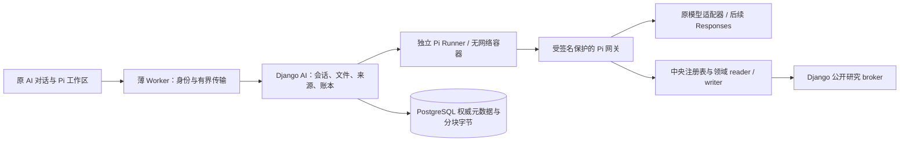

# AI 助理能力补齐施工方案

版本：2026-10-28；源码基线：`72d07ad77a858b9ecf2ab960140e8c052de19e3c`。

本方案针对“模型与外部 API 能力相同时，系统还需要补齐什么才能完成更完整的任务”。本次仅交付方案，未修改应用、运行功能测试、读取凭据、调用付费模型或操作生产。下文的接口、表、字段和文件名标为“拟定”时均属于施工设计，不代表已实现或已采用。实际开发前重新核对最新 main 的变化和部署兼容性，不按本基线覆盖后续工作。

执行依据为根 [AGENTS.md](../../AGENTS.md)、[开发与交付](../规范/开发与交付.md)、[任务模型分工](../规范/任务模型分工.md)、[系统架构](../规范/系统架构.md)、[前端与性能](../规范/前端与性能.md)、[安全与 AI 工具](../规范/安全与AI工具.md)、[数据存储与迁移](../规范/数据存储与迁移.md)、[验证与发布](../规范/验证与发布.md)。根入口规定的“合并、制品准备、发布分别取得当次授权”优先于专题中遗留的连续交付表述。方案通过不构成实施、合并、准备或上线授权。

## 1. 目标、范围与实施原则

目标是让用户在同一 Pi 环境中完成“理解材料—查询经营数据—查阅公开资料—计算分析—交付文件—继续追问”，充分使用已有模型能力，并明确每个结论的依据、缺口和当前任务状态。优先解决现成工具不可达、附件进入不了视觉链路、研究需要人工搬运等实际断点。

继续使用现有 React 页面、薄 Worker、Django AI 域、中央工具注册表及独立 Pi Runner，不重建 Agent、模型管理、记忆、Skills 或业务写入系统。保留用户配置的长上下文、高输出、长任务时限与自由参数；仅按供应商真实支持、参数关系、权限和资源边界拒绝无效输入，不以“省成本”为由静默降档、缩短任务或截断答案。

首批包含现有工具及记忆接通、多模态与较大附件、自主公开研究；第二批改善 Pi 实时输出、上下文管理及知识质量；第三批按供应商接入原生 Responses 并扩展业务连接。Responses 不是第一批多模态或研究工具的前置条件。语音、动态登录浏览器、任意用户插件安装、通用桌面控制和自动外发不在首批范围，后续按实际需求另立边界。

新增资源预算是可配置执行策略，不能混同模型产品上限。暂停、取消、关闭、终态、结果未知分别保留；已发出的模型请求、业务写入和消息投递结果未知时不自动重放。本文不承诺工期、百分比收益或当前生产已具备某项能力。

## 2. 现状事实与具体使用场景

| 已有事实及证据 | 当前接缝 | 本次处理 |
| --- | --- | --- |
| [Pi 运行说明](../技术专题/AI助手/pi-agent-runtime.md)及 [pi_native.py](../../backend/ai_assistant/pi_native.py)已有计划、问卷、子代理、消息、等待和取消 | 源码存在不证明结构、Runner、镜像及旧环境均已采用 | 复用；发布材料分别声明各层状态 |
| [pi_workspace.py](../../backend/ai_assistant/pi_workspace.py)已有终端、文件、依赖安装、插话、会话树和手动压缩 | 不能把现有终端和 Skills 重新列为缺失 | 增量接线，保留现有控制身份 |
| [tool-registry.ts](../../lib/ai/tool-registry.ts)有知识、记忆、推广诊断和新版网店工具；[pi_gateway.py](../../backend/ai_assistant/pi_gateway.py)按 `pi_agent` 筛选 | 部分工具未开放该 surface；只增加 schema 不能使调用全链路生效 | 逐项补 surface、handler、后端准入及 scope |
| [gateway-extension.mjs](../../containers/pi-agent/gateway-extension.mjs)只提取文本块；Pi 网关要求文本 content | 附件可保存、脚本可读取，不代表模型可看图或 PDF 页面 | 引入受控内容块与视觉投递 |
| [pi_service.py](../../backend/ai_assistant/pi_service.py)输入 512 KiB、输出 8 MiB；[pi_models.py](../../backend/ai_assistant/pi_models.py)保存文件字节 | 大工作簿/PDF容易在上传前被拒；链路还有独立请求边界 | 分片上传、流式下载及分片入容器 |
| [pi_research.py](../../backend/ai_assistant/pi_research.py)已有公网 GET；[工作区界面](../../app/ai-pi-workspace.tsx)由用户填写并引用研究结果 | 模型工具目录中没有完整自主研究入口 | 复用读取器并接中央注册表 |
| [provider.py](../../backend/ai_assistant/provider.py)已有 Chat Completions/Messages；[model_capabilities.py](../../backend/ai_assistant/model_capabilities.py)已有参数能力处理 | Pi 未把模型文本增量接到用户；没有原生 Responses 路由 | 分批增量实现，维持原适配器 |
| [memory.py](../../backend/ai_assistant/memory.py)有确认、scope、CAS和审计；[knowledge.py](../../backend/ai_assistant/knowledge.py)有版本化词法检索 | 记忆整句包含匹配较弱，知识只扫描最新100条候选 | 先接通，再改索引与召回 |
| [pi_exports.py](../../backend/ai_assistant/pi_exports.py)保留截止日、版本、SHA及完整性 | `live_per_page` 明确不等于跨页原子快照 | 引用保留一致性等级，不伪造完整快照 |

首批围绕以下场景施工：

1. 用户说“按我保存的利润口径，解释这家店本月推广变化”，Pi能找到允许使用的个人口径和现有推广工具，显示实际期间、数据覆盖和出处；不能从旧聊天补数字。
2. 用户上传带图的 PDF、商品照片和较大 Excel，要求结合系统销量做分析。系统区分表格解析、图像视觉和扫描页识别，列出未读页面、公式缓存及映射歧义，并交付可下载文件。
3. 用户要求查询某公开产品规格或平台公开规则，模型在本轮允许的公开研究范围内搜索、阅读多页并引用；内部成本、客户资料和私人记忆不进入外部搜索词。
4. 后续用户在长任务中刷新、插话或断网后返回，能继续看原任务及已完成文件；若模型结果未知，页面解释缺口并只观察原记录，不通过再发一次掩盖状态。

## 3. 复用架构与分期依赖



Worker不承担网页抓取、长期解析或新领域业务。容器不获得生产数据库、模型密钥、浏览器 Cookie、宿主目录或网络；模型调用、数据查询与公开研究仍经容器外受控入口。文件进入模型不新增业务权限，网页文字与知识条目都是低信任数据。

| 阶段 | 范围与交付单位 | 依赖、相对复杂度 |
| --- | --- | --- |
| A1 | 工具覆盖清单、知识/记忆及现有业务工具接通 | 可先交付；中，重点是调用链与单店归属 |
| A2 | 分片文件、隔离解析、图像/PDF内容块、来源卡 | 高；文件契约→存储/传输→解析→模型→界面是关键路径 |
| A3 | 模型研究工具、公开研究范围与来源引用 | 中；复用 A2 的来源结构，可与 A2 解析并行施工 |
| B1 | Pi 文本增量、可见进度、压缩和原操作恢复体验 | 中高；先稳定事件身份，随后引入安全点压缩 |
| B2 | 全量有界知识索引、混合检索、记忆候选 | 中高；先词法索引，向量为独立可选增量 |
| C1 | 按供应商启用 Responses | 高；取决于实际端点、能力和持久状态政策 |
| C2 | 新注册业务流程、连接器、技能维护、成本汇总 | 按连接器拆交付，不与 C1 强行绑定 |

每阶段在独立 `codex/*` worktree开发；一个负责人集成，关键权限、状态和存储契约由独立审查上下文核对。审查与实现均遵守发布分工，不通过方案额外引入 AI 功能测试或业务验收门槛。

## 4. 首批开发任务表

“完成形态”是需交付的代码和材料，不表示本方案已实现。已有路径可直接定位；拟新增路径仅为建议命名，实施时与仓库最新组织方式核对。

| 编号 | 开发动作与完成形态 | 入口 / 拟新增文件 |
| --- | --- | --- |
| A01 | 输出工具差异矩阵：当前surface、角色、scope、执行模式、schema、handler、领域准入、单店可用性 | [tool-registry.ts](../../lib/ai/tool-registry.ts)、[pi_gateway.py](../../backend/ai_assistant/pi_gateway.py) |
| A02 | 逐项接通知识/记忆、推广诊断、商品表现及推广insights；保持其他surface原权限，不能仅改模型展示目录 | 同上；[pi_selection.py](../../backend/ai_assistant/pi_selection.py)、[transport.py](../../backend/ai_assistant/transport.py) |
| A03 | Pi轮次装配有界上下文；记录实际命中的条目版本及来源，scope变化后重算 | 拟 `backend/ai_assistant/pi_context.py`；复用memory/knowledge |
| A04 | 定义文件协议版本、上传会话、片身份、最终manifest、解析与引用状态 | 拟 `backend/ai_assistant/pi_file_models.py`、新migration |
| A05 | 实现创建/续传/提交/取消上传，服务端核总量与SHA；拒绝同片序号异内容 | 拟 `backend/ai_assistant/pi_file_uploads.py`；[pi_views.py](../../backend/ai_assistant/pi_views.py) |
| A06 | Worker逐片薄转发和有界下载，禁止完成后重新拼成完整JSON/base64 | 拟 `app/api/ai/pi/uploads/`；[django-route.ts](../../lib/ai/django-route.ts)、[ai-service.ts](../../lib/django/ai-service.ts) |
| A07 | 文件面板显示续传、完整性、解析进度和失败原因；保留原下载入口 | [ai-pi-agent-view.tsx](../../app/ai-pi-agent-view.tsx)、[ai-pi-workspace.tsx](../../app/ai-pi-workspace.tsx) |
| A08 | 扩展Django→Runner分片输入、产物回收及子代理handoff，临时文件校验后原子完成；所有写者和版本受原冻结机制约束 | [pi_worker.py](../../backend/ai_assistant/pi_worker.py)、[file-transfer.py](../../containers/pi-agent/file-transfer.py)、[workspace.py](../../backend/pi_runner/workspace.py)、pi_native |
| A09 | 新建固定解析任务：PDF文本/页图、工作簿清单与数据、图片归一化；保存页/单元格引用及缺口 | 拟 `containers/pi-agent/document-extract.py`、`backend/ai_assistant/pi_documents.py` |
| A10 | 贯通内容块：浏览器选择→Pi历史→gateway→provider；能力不支持时给出明确状态 | [gateway-extension.mjs](../../containers/pi-agent/gateway-extension.mjs)、[pi_gateway.py](../../backend/ai_assistant/pi_gateway.py)、provider/model_capabilities |
| A11 | 统一来源目录和回答引用，绑定实际读取回执；下载文件manifest记录引用 | 拟 `backend/ai_assistant/pi_sources.py`、`app/ai-source-citations.tsx` |
| A12 | 注册公开搜索/读取；TS handler只做鉴权契约与Django转接，真实读取在原broker | tool-registry；拟 `lib/ai/pi-research-tools.ts`，复用pi_research |
| A13 | 研究范围可视化、外发参数限制、研究结果进入同轮上下文；原手动研究入口继续保留 | pi_gateway、pi_workspace及原工作区界面 |
| A14 | 交付结构recipe、角色/readiness/备份清单、Runner协议与镜像绑定、旧会话说明 | [tools/pi_native_catalog.py](../../tools/pi_native_catalog.py)等现有有限升级体系；新增对应代际文件 |

首批A01工具清单如下；“接通”包含目录、handler、传输及所属后端准入，不等于统一放宽原权限。

| 已有工具名称 | 施工重点 |
| --- | --- |
| `search_system_knowledge`、`search_personal_memory` | 自动召回和模型主动检索共用同一可见性规则，落实下文受信Pi环境绑定 |
| `get_jd_promotion_diagnostic` | 保留原支持店铺、角色、期间与对象证据边界 |
| `get_netshop_insights_context`、`get_netshop_product_insights` | 保留范围、覆盖、快照及分页语义，单店归属由所属reader证明 |
| `get_netshop_promotion_insights`、`get_netshop_promotion_object_detail` | 保留对象权限及原sectionToken，不从列表标识猜明细；逐项配套filter_catalog/bind_arguments |

## 5. 数据与调用契约

以下是拟定 v1 契约，字段统一使用严格对象 schema、拒绝未知字段。真实owner、角色、scope、epoch、generation由服务端注入，客户端或模型不能自报授权。请求身份绑定参数摘要；改变参数必须形成明确的新动作，不能复用旧身份篡改内容。

| 对象 | 必要字段与约束 |
| --- | --- |
| `ContentPart` | `type=text/image/file_reference`；文本为text，文件引用为fileId、sha256、page或sheet/range；不接受模型任意URL冒充私有附件 |
| `Upload` | uploadId、sessionId、generation、fileName、declaredMime、sizeBytes、sha256、chunkBytes、chunkCount、status、version；片索引唯一、片SHA与长度固定 |
| `SourceRef` | sourceId、kind、title、locator、version/sha256、observedAt、cutoff、scopeBinding、completeness、readReceiptId；字段按来源类型可为空但不得伪造 |
| `Citation` | sourceId、定位片段或页/单元格范围、readReceiptId；展示引用前核当前用户仍可见 |
| `CapabilitySnapshot` | provider协议、modelId/version、文本/图像/文档/工具/流式支持、supportedThinkingLevels、配置参数及实际请求参数摘要、契约版本 |
| `TaskEvent` | eventId、operationId、generation、seq、kind、timestamp、payload；增量文本另有messageId与offset，最终结果有内容摘要 |

拟定调用示例，仅展示业务字段：

```json
{
  "clientRequestId": "upload-fixed-id",
  "fileName": "月度分析.pdf",
  "sizeBytes": 15728640,
  "sha256": "<64位文件摘要>",
  "chunkBytes": 524288,
  "declaredMime": "application/pdf"
}
```

```json
{
  "schemaVersion": 1,
  "message": "结合附件第3页与该店销量说明差异",
  "attachments": [{"fileId": "pi-file-id", "sha256": "<摘要>", "pages": [3]}],
  "publicResearch": {"enabled": true, "scopeId": "public-scope-id"}
}
```

消息格式保留原文本兼容入口；只有具备新协议的会话才能使用新附件字段。中央工具拟增加 `search_public_sources`、`read_public_source`、`read_attachment_pages`，返回结构化来源/页面定位和完整性，不返回任意网络代理或业务写权限。模型调用 `read_public_source` 只能提供broker持有的sourceId或用户已明确批准URL的引用ID，不接受模型自行构造或修改URL。工具风险、执行模式和次数分别声明：只读结果接口可direct，可能较久的解析使用持久任务；异步受理不能宣称解析完成。

模型能力沿现有矩阵扩展，区分配置声称、适配器支持和实际确认状态。普通文本调用不能证明视觉或工具流式已支持。未知能力明确提示；不在后台自行发收费探测。供应商不支持某内容类型时，可选择已配置且获准的视觉模型或隔离文本提取路径，不能静默丢图后仍说“已看过图片”。

## 6. 文件分片、存储与清理

首版选择 **PostgreSQL AI域保存权威元数据及不可变分块字节，Runner named volume保存工作副本**。这与现有Pi文件和存储规范一致，不恢复已退役AI R2前缀，也不引入Windows任意目录作为附件库。以后若需要独立对象存储，须单独决策、迁移和授权，不能在首版混用两个事实源。

拟新增上传会话/分块表，并扩展 `PiFile` 的storageKind及块manifest关联；原 `payload` 内联字节继续保留可读。新文件只有总SHA、片清单、大小和权限都通过后才发布为ready的PiFile；提交只改变引用/状态，不复制整份字节形成第二份权威对象。新约束区分inline和chunked：前者保留现有完整性约束，后者要求payload为空且manifest完整，不能只把原8MiB约束删除。

拟定路由为 `POST /api/ai/pi/sessions/{id}/uploads`、`POST /api/ai/pi/uploads/{id}/chunks/{index}`、`GET /api/ai/pi/uploads/{id}`、`POST .../complete`和`POST .../cancel`。同一片重复且SHA一致返回原回执；不同字节冲突；完成采用CAS，缺片保持uploading。刷新只查询已收片位图，不新建上传。每次写片、完成、取片及导入容器重查当前账号、代际和scope。

首版片大小建议512KiB原始字节，base64后约683KiB，加固定信封仍须小于当前内部1MiB限制。真实边界还包括Pi上传720KiB JSON、消息800KiB及workspace1600KiB等现行限制，见 [django-route.ts](../../lib/ai/django-route.ts) 与 [ai-service.ts](../../lib/django/ai-service.ts)。新片路由使用单独严格预算，任何层都不能借全局放宽解除其他接口约束。下载采用授权二进制流或分片读取，不在原content响应重新组装大base64。当前[pi_worker.py](../../backend/ai_assistant/pi_worker.py)把 `download(content=True)` 的完整base64附入prompt，该路径必须对新文件改为manifest引用和独立有界传输；Runner逐片接收、校验后原子落位。产物回收和子代理handoff使用同一分片/manifest契约，交接仍需原权限、不可变快照和目标代际绑定，不能复制全量base64进消息；旧inline保留兼容。只改前端上限不算完成。

建议首版资源策略从每文件32MiB、每轮128MiB、受限并发开始，作为可调整初值，不作为模型上下文上限或已验证吞吐承诺。实际实施结合传输、容器内存和存储保留预算冻结配置；总字节、解压后大小、文件数量、页数、像素和处理时间分别计量，超限说明具体边界。输出文件继续保留原8MiB兼容路径，较大产物通过同一分块存储协议交付，不能承诺大输入一定能经旧出口导出。

未完成上传可设独立过期策略，但默认先标记待清理；已被operation、引用、交接或unknown记录绑定的字节不自动删除。物理清理由独立受管任务按引用和保留政策处理，保留删除审计。现有持久会话无自动删除TTL的行为不被本方案暗中改变。

## 7. 视觉与 PDF/表格处理闭环

文件ready后先做被动识别：校验真实格式、页数/像素、压缩成员及解压总量，不执行宏、外链、嵌入脚本或用户传入解析代码。固定解析器及锁定依赖放进独立Pi镜像，Django只调度和保存结果；恶意或损坏文档在隔离处理器失败，不进入宿主Office或Python执行。

PDF优先提取文字及页码；图表、扫描页和布局依赖内容按需渲染页图。图像归一化保留原始SHA、页号、变换参数和衍生SHA；识别/OCR结果标注来源及不确定性，不把转成文字视为逐页视觉已完成。模型选择读取哪些页面时先看页面目录，再请求所需页；最终回答披露实际读取页、未处理页与限额。表格读取保留工作表、单元格范围、公式及缓存差异，不执行宏，不把未计算缓存当实时公式结果。

视觉通道由服务端根据fileId定位不可变派生图，构造对应供应商内容块。供应商支持PDF原生输入时可作为独立能力选项；首版不依赖它，也不默认把全部文档上传到供应商文件库。每个模型派发记录实际发送的文件/页面摘要与能力快照，模型无法请求其他会话文件。对图片和PDF的“已读”证据应来自真实请求包含情况，不能仅因上传成功打勾。

Runner原生read可能生成图像块，适配层必须保留并在网关检查类型、大小与来源；不能继续通过 `text(content)`丢弃。新增消息协议须覆盖历史序列化、分叉、子代理文件交接、权限代际切换和最终下载，不只修改provider请求一处。引用和解析结果是派生数据，模型内容不能覆盖原文件。

## 8. 自主公开研究与来源引用

复用现有Bing RSS搜索及公网GET读取作为第一种后端，后续搜索供应商可替换为适配器，但结果字段保持一致。当前来源能力有限，不把前8条搜索结果称为全网完整覆盖；网页正文读取失败、动态内容、付费墙和时间不可知分别说明。

用户提出公开研究任务或在本轮启用公开研究后，形成服务端研究范围：允许的公开主题/实体、可选域名、资料类型和有效任务。范围内搜索和读页不逐次要求点击。自动搜索词由明确允许的公开种子与受控查询模板构成；从已读取公开来源发现的新实体须带原sourceId和定位供broker核对。任意自由搜索词、新的私有材料内容或业务数据不能靠模型自报“公开”放行，超出范围先提供具体外发预览，由用户决定是否扩大范围。

请求不给搜索端发送聊天历史、文件正文、账号身份、私人记忆、内部SKU备注或经营数字。敏感词检测是补充，不能代替范围与来源约束。保持已有DNS公网校验、重定向逐跳检查、SSRF限制、固定超时/字节上限和无Cookie机制；不为浏览动态网页给数据容器联网。所有外部文字只作为资料，不能触发权限升级、密钥访问或工具安装。

读取URL也是外发，不能仅限制搜索词。broker只登记已准入搜索结果、已读公开页面解析出的链接或用户明确批准的精确URL，绑定scopeId、来源回执及规范化地址；模型只能选引用ID，不能改写其host、path或query，也不能把内部数据拼入URL。读取时服务端重新核引用归属和研究范围，逐跳重定向同时检查公网SSRF与范围规则；新地址超出范围则阻止并提供具体外发预览。公网可达不代表该地址可发送，旧手动读取与模型读取走同一外发准入。

每次搜索/读取返回sourceId、实际URL、标题、获取时间、内容摘要、可用正文及截断状态。业务数据引用附原工具调用身份、查询范围、来源修订和截止日；附件引用附文件SHA、页或单元格定位。回答中的引用由界面用sourceId解析成可读来源卡，禁止模型自行拼私有下载URL。可见引用意味着已授权读取相应片段，不意味着内容必然正确；相互矛盾和过期信息照实列出。

## 9. 第二批：流式、长上下文与恢复

| 编号 | 施工动作 | 关键入口 |
| --- | --- | --- |
| B01 | provider文本增量写入Pi持久事件，浏览器即时显示，最终消息去重结算 | provider、pi_gateway、pi_service.events、ai-pi-agent-view |
| B02 | 显示读取、解析、模型生成、等待子代理、收集产物等真实阶段；不编造百分比 | pi_worker、pi_native、原事件面板 |
| B03 | 增加上下文预算展示与安全点压缩调度，保留手动compact | pi_workspace、[entrypoint.mjs](../../containers/pi-agent/entrypoint.mjs)、model_capabilities |
| B04 | 原操作状态协调卡，区分仅断线、已取消、已完成、未知及允许继续的范围 | pi_workspace、pi_service、Runner原账本 |
| B05 | 知识索引与记忆候选、确认、冲突更新及来源失效 | memory、knowledge；拟 `knowledge_index.py`与结构迁移 |

首版流式采用“Django持续保存公开文本delta并交前端，最终完整结果再回Pi”的兼容路径。当前Pi内部网关是一次UI请求/回答协议，不能把最终整段转成一次text_delta称为流式。`provider.turn`使用已有 `on_text`回调，增量按有界字符/时间批次提交；浏览器复用事件游标轮询或新增只读SSE，断线按seq补读。隐藏推理、providerFrame和敏感工具参数不进入事件流。

messageId绑定原dispatch，delta有offset，最终assistant消息作为完整替换而非再次追加；完成必须仍有原最终模型响应、Pi settled和文件收集回执。浏览器关闭不取消后台，重复订阅不发起模型请求。若之后需要Pi内部也消费供应商实时块，再单独升级Runner流协议，不能与上述兼容路径混为已完成。

上下文压缩仅在无未决工具结果、无活动写者且控制账本允许的安全点执行，复用原compact控制身份。压缩内容保留目标、约束、用户决定、计划版本、已完成事项、来源ID、文件摘要和待解决问题，不把完整业务文件反复塞回提示词。触发阈值由实际上下文窗、用户输出预算及工具预留共同计算，可调且透明，不固定砍掉历史或降低maxTokens。摘要注明来源范围与丢弃细节，原历史继续可追溯；摘要不是永久记忆或授权。

恢复优先读取原operation/dispatch/control。已终态者展示原结果，仍运行者续订事件，scope改变者隔离旧环境。模型HTTP发送后连接断开且无可信最终回执时保持unknown，即使当时尚未执行业务工具也不能假定模型请求未收费或未处理。只有原协议能证明未派发或服务商支持原请求结果查询时，才能协调；不自动切供应商、换请求ID、重新prompt或重做compact。业务写入继续原actionId与领域回执，暂停不等于回滚。

知识质量按两步改进：先对全部有效授权知识建立可分页候选索引，使用标题/标签/正文分词、多查询与确定性重排，消除“只看最新100条”的覆盖缺口；再按语料与检索效果引入可选向量索引。向量是派生数据，须绑定条目版本、切块方式和embedding模型版本；权限在候选召回前及内容返回前都生效，不让隐藏文档标题泄漏。停用或更新条目立即失效旧chunk，未重建时回退合规词法路径，不能返回过期向量正文。

个人偏好、业务术语、稳定背景仍保留原确认与scope规则。新增记忆候选只呈现拟保存内容和依据，确认后调用原save/CAS；冲突时展示旧值与新值，不静默覆盖。当前经营数字、客户敏感内容和模型猜测不进入长期记忆。Pi自动召回使用当前owner与授权交集，并标注低信任；普通Chat/钉钉的现有私有上下文隔离保持。

## 10. 第三批：原生 Responses 与业务扩展

Responses作为明确配置的provider协议增量，拟新增 `backend/ai_assistant/provider_responses.py`，保留Chat Completions/Messages的适用路径，不依据域名或“兼容OpenAI”自动切换。统一内部结果须保留文本、工具调用ID与参数、用量、停止原因、错误码及需要延续的供应商状态；无法无损表达的能力单独声明，不把协议字段硬塞进旧文本。

`previous_response_id`、供应商存储、后台执行、内置搜索和file search分别开关、分别记录适用性。供应商持久对话ID绑定owner、session、generation和modelVersion；权限收窄或切模型后不能盲目续接旧远端上下文。默认不上传知识库或业务文件到外部向量库；确需使用先明确内容范围、保留与删除政策。后台受理只表示供应商接收，取消本地等待不证明远端取消；首个POST结果未知且没有可查询ID时仍保持unknown。

业务扩展沿现有 [pi_business.py](../../backend/ai_assistant/pi_business.py) 的意图、预览、确认、动作账本和唯一执行者。优先将实际频繁的已注册n8n补缺、报告接收渠道与只读资料连接器逐项纳入；每项给出领域writer、参数版本、目标scope、幂等键、确认要求和未知协调方法。不能因为接入了Responses或Skills就开放任意SQL、任意HTTP写或正式账号浏览器。

技能扩展另增审核与版本发布流程，继续固定本轮资源摘要。成本管理复用现有dispatch用量，增加历史模型价格版本、币种和整棵代理树汇总；缺失用量或价格显示未知，不推算真实账单，不通过成本功能修改用户模型参数。

## 11. 权限、单店及兼容设计

`viewer/analyst/operator/admin`、真实principal、surface及领域权限继续决定调用资格。Pi创建和执行保留原角色限制；不能仅因某只读工具允许viewer，就绕过Pi环境本身的限制。所有新增模型可调用能力只在中央注册表声明一次，类型、风险、调用次数、超时和结果上限齐全，审计不可用仍失败关闭。

单店环境只允许可证明该精确平台/店铺归属的数据。现有 `pi_selection.py`限制是有意边界：ERP渠道、仓库及全局库存不能直接当作店铺。新增推广/商品工具需由领域reader落实相同店铺过滤，再加入单店allowlist；暂时不能证明的能力显示不支持，不扩大查询后让模型自己过滤。单店下个人偏好/通用术语可按既有owner规则使用，业务背景记忆必须带可核店铺归属，否则不注入；系统知识只开放不含其他店经营数据的稳定解释。

该限制同时适用于自动注入和模型主动调用知识/记忆搜索。当前handler只传principal，而shopSelection不是principal.scope，故不能只加surface和allowlist。拟在受签名保护的执行context中携带服务端产生的Pi operation/session/generation绑定，AI后端从原operation解析可信shopSelection，与当前principal交叉核验；此绑定不进入模型可填schema。Pi专用薄适配将绑定转交所属AI服务，自动召回和主动搜索均调用同一可见性过滤函数。未知店铺归属的业务记忆及知识内容拒绝返回，不只从自动提示词删去；缺少或过期绑定的Pi查询失败关闭。其他surface继续原规则，不能借新参数伪装为Pi或声明任意店铺。

文件、研究scope、来源引用、解析任务、摘要和子代理交接均绑定环境代际。fork保留原历史引用可见性检查，不复制业务授权；新子代理只取得显式交接的文件快照与权限交集。旧环境不得通过新协议字段访问新能力。

Runner增加能力握手，至少分别报告chunkedFiles、contentParts、documentExtract和协议版本；不凭镜像标签推定。原会话继续原镜像和卷，界面显示“不支持新附件/需升级或新建环境”；采用原已登记镜像升级流程，不把旧volume直接挂新镜像。现有inline文件仍可下载和续用，旧消息文本仍可读，新代码不得强迫重跑历史任务。升级、重置、暂停和取消保持不同语义，未知旧操作不靠升级解除。

## 12. 迁移、权限与发布组件

迁移编号以实施时最新main为准，不预占或改写0084—0087。优先采用新增表、可空列和兼容读取；依赖历史数据才能成立的非空/唯一约束分阶段处理。迁移只创建结构、索引、约束及必要权限，不把历史附件拆块、历史知识embedding或业务清洗放入 `RunPython`自动执行。

| 结构增量 | 权限/readiness/备份配套 | 独立数据任务 |
| --- | --- | --- |
| 上传会话、块、PiFile存储种类 | AI writer写与受控读；一般reader不因下载获取全库块权限；核表/索引/约束和authority | 旧inline不搬；日后搬迁另授权 |
| 解析任务、来源与片段索引 | worker领取租约与fencing；引用按owner/scope读；失败不影响其他域 | 旧文件重解析另授权 |
| 知识chunk/索引、可选向量版本 | 沿知识角色过滤，派生索引专用权限；不扩大业务reader | 既有知识回填、embedding费用单独授权 |
| 内容协议/能力版本、必要事件字段 | 原Pi账本兼容、schema/readiness与备份恢复表清单一致 | 历史事件不改写；新版本从新增记录生效 |

为新增AI表同步有限结构catalog/recipe、模型注册、最小角色、readiness及备份/恢复清单；分块字节随权威库备份策略处理，Runner副本不能替代它。结构发布不默认追加前后全库备份或全库恢复演练；日常备份独立管理，既有工具内置门禁保留。未知采用状态、未配置权限或不兼容镜像必须如实报告，不能靠关闭readiness解决。

| 交付阶段 | 预计组件范围，最终以完整Git差异为准 |
| --- | --- |
| 本方案文档 | 仅文档；不准备应用制品、不迁移、不上线 |
| A1 | Worker＋Django；若不新增持久字段则无migration/镜像变化 |
| A2 | Worker＋Django＋结构recipe＋Runner源码/新镜像/依赖锁；全部绑定同一采用计划 |
| A3 | Worker＋Django；若新增研究范围/来源表则有结构；Runner是否变化以实际协议为准 |
| B1/B2 | Worker＋Django及实际新增结构；压缩控制或提取依赖变化才涉及Runner/镜像 |
| C1/C2 | 按适配器、连接器及n8n实际差异分别计划；不因后端变更重建无关组件 |

每阶段先完成可审查源码、必要资料及构建/部署/启动所需代码检查。随后三个阶段分别取得用户对本次的明确授权：合并main并推送核远端，完成后停下；获制品准备授权后生成绑定最终提交的对应制品，完成后停下；获发布授权后按原生入口采用就绪制品。不得提前打包、通过hook跨阶段或把开发授权视为发布授权。

AI检查仅限必要语法、类型、依赖、构建闭包、迁移安装/启动入口及调用参数；不默认执行功能测试、业务接口/权限场景验收、真实模型调用或综合验收。发布成功依据原生完成回执报告，不另追加独立业务或健康扫描。恢复使用原协议的兼容修复或前向修复，不删除新账本、不回写旧D1或把已发生作用重新派发。

## 13. 风险、取舍与用户检测

| 风险或取舍 | 处理方向 |
| --- | --- |
| 分块字节增加PostgreSQL容量、WAL和备份量 | 有界文件/会话配额、去重限同owner/scope、防大事务、独立保留政策；不把对象存储迁移夹入首批 |
| 视觉/OCR可能误读，长PDF容易只读局部 | 页面索引、真实投递回执、低置信与未读提示；重要数字关联表格/业务工具，不保证视觉等于事实 |
| 公网研究可能泄漏查询或受提示注入影响 | 研究范围、受控种子与查询模板、无私有上下文外发、内容低信任；自由搜索扩大范围需明确决定 |
| 流式落库增加写压力、显示重复 | 批次delta、游标补读、最终替换及背压；不持久化隐藏推理，不承诺每token一个事件 |
| 旧镜像/结构/消息协议混合 | 能力握手与逐环境兼容，不强制迁移活动卷；不支持就明确拒绝 |
| 向量检索增加费用和数据外传 | 词法优先；embedding来源、费用、权限和回填另定，不默认第三方上传 |
| 更强自主性放大重试副作用 | 原意图、原dispatch、原actionId和结果协调优先，unknown不自动降级或重发 |

以下是上线后供用户自行检测的场景清单，不是AI本次或发布前需执行的验收，也不是本方案对当前功能通过的声明：

1. 在普通Pi及单店Pi询问已保存偏好、术语和跨店背景，检查召回内容与范围是否符合预期；查询原Chat及钉钉，确认私有上下文隔离符合原行为。
2. 上传超过512KiB的表格/PDF，上传中刷新再续传，观察原uploadId、缺片提示及最终文件SHA；尝试同名不同文件应有清晰区分。
3. 询问指定图片细节、PDF扫描页及跨页图表，检查实际读取页、引用和未识别信息；选择不支持视觉的模型，应明确说明替代路径。
4. 要求查公开规格并比较多来源，观察模型是否自主研究、能否打开引用，以及业务文件内容是否出现在外发预览中；超范围请求不应静默外发。
5. 长回答生成时刷新/断网后返回，检查文本是否连续、无重复；停止时观察后续派发是否停止，已有文件是否保留。
6. 长任务触发压缩后追问原约束与文件，检查摘要、来源和待办是否保留；未决或unknown任务不应被自动重跑。
7. 在旧环境打开新附件功能，检查升级提示及历史文件可用性；分叉/子代理不能取得未交接的文件或业务授权。
8. 业务扩展上线后，由用户按实际任务检查预览、确认、成功/未知状态及原对象链接；不以模型口头“完成”代替领域回执。

## 14. 施工启动与参考

建议第一批按A01—A03先补现有接线，A04—A11完成附件全链路，A12—A14完成自主研究及统一交付。实施开始先冻结三份材料：工具可达矩阵、附件/内容/来源契约、逐组件兼容表；这些是开发材料，不提前生成生产制品。遇到字段或路径已由其他任务实现时先复用并缩减工作单。

需在实现方案中明确并记录的取舍包括：首版附件资源初值、允许自动研究的公开主题构成、支持的解析格式、旧环境升级选择、是否使用外部embedding及具体供应商Responses能力。可在本方案建议范围内细化工程参数；涉及新增费用、私有资料外传、真实业务动作或生产采用时仍需要相应用户授权，不将等待这些决定的部分冒称已完成。

公开资料依据为本轮已核验的OpenAI官方指南：[Tools](https://developers.openai.com/api/docs/guides/tools)、[Images and vision](https://developers.openai.com/api/docs/guides/images-vision)、[File search](https://developers.openai.com/api/docs/guides/tools-file-search)、[Background mode](https://developers.openai.com/api/docs/guides/background)。这些资料分别用于区分模型工具与应用执行器、视觉输入链路、托管检索和异步响应状态；不证明本系统、任意兼容供应商或当前账户已支持对应能力。实际施工继续以本项目源码契约、选用供应商和当时可核验能力为准。
