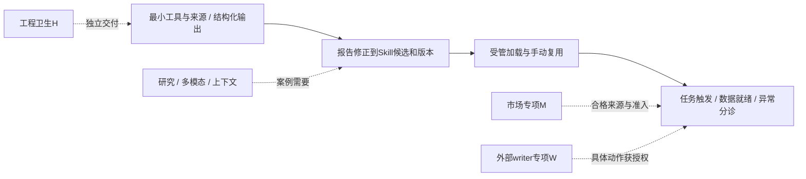

# AI助理统一施工方案 v3.1

日期：2026-10-29。源码核对基线：`bf9d81e318421ad110f74f99b9766003d10729f4`，来自本次最新 `origin/main`。v3.1纳入推广链费用补充及其事实修正，主线阶段与独立专项划分保持。
本文件统一任务/Skill方案、能力复核、F1—F8修复建议及最新审查结论，作为自足的施工正文；执行不依赖其他工作树中的旧PLAN或FIXPLAN。
所有新增名称、接口与字段为当时拟定，开发前核对最新main。

> **2026-11-05 进度批注**：本方案已部分实施，**且已完成的部分全部上线**。
> P0-01—P0-04 与 P1a 候选侧已合并 main 并随 `ece8c7ec` 发布到生产
> （`PUBLISHED-MAIN.json` 为 `deployed_and_ready`，schema 回执
> `AiTaskFeedbackCandidates 156→158`，`installed`/`finalized` 均 `verified`）。
> 其余工作包仍为方案状态，**无任何半上线或部分启用的中间态**。
> 各包状态见第 3 节表格"状态"列，逐项证据见第 3.1 节。
> 正文其余章节未随实施回写，描述与已落地代码可能有细节差异，施工前以 main 实际代码为准。

## 1. 目标、原则与最小首批

主线保持 **P0最小底座→P1报告与用户修正形成Skill→P2受授权自动任务与异常分诊→P3按需要扩展能力**。
经营日报、推广诊断、库存补货贯穿全程。先完成实际任务的报告和可观察执行记录，再提炼可复用方法；不用等全平台工具、市场五角色链或外部平台写入全部建成。

复用React主界面、薄Worker、Django AI域、中央工具注册表、Pi独立容器及原账本。已有终端、文件、Skills、计划、问卷、子代理、会话分叉和业务动作不重建。
保留用户的长上下文、高输出、长任务时限及自由参数；只按供应商真实支持、有效参数关系、权限与资源边界处理，不静默降档。

最小首批拆成两个可交付切片：

1. **P0＋P1a**：一个可证明店铺归属的日报范围，必要工具、来源、报告下载、明确修正、结构化Skill候选及审核发布的数据层闭环；实际任务可先用现有内置Skill/文字指导。
2. **P1b**：发布版本经受管快照进入Pi真实发现、读取、执行，再在另一日期手动复用。P1a可先交付，但只有P1b完成才称“产品Skill在Pi中可复用”。

P2先做一个明确授权的钉钉任务，再扩触发类型。P3公开研究可因竞品案例前移，内部日报无需因此等待。
并行工程卫生H、市场启用专项M、外部平台writer专项W各自交付；不将它们全部完成作为首个Skill的前置条件。

“真实任务”由用户在能力采用后发起或明确授权。报告生成、用户更正均不证明尚未执行的推广/补货建议有效；候选继续标注未验证建议，不追加AI业务测试来消除标签。

## 2. 事实基线：已存在、接线缺口与独立专项

| 能力与证据 | 已存在的实现 | 本次增量及状态边界 |
| --- | --- | --- |
| [Pi运行说明](../技术专题/AI助手/pi-agent-runtime.md)、[pi_native.py](../../backend/ai_assistant/pi_native.py) | 计划、问卷、子代理、消息、等待、取消及独立任务树 | 复用；源码存在不证明生产结构/Runner/镜像均已采用 |
| [pi_workspace.py](../../backend/ai_assistant/pi_workspace.py) | 终端、文件、依赖、插话、分叉、手动compact | 补可见执行记录、流式及受控上下文管理 |
| [report_library.py](../../backend/ai_assistant/report_library.py)、[report_models.py](../../backend/ai_assistant/report_models.py) | 三类文字skills/templates/pipelines、AiLibraryRevision、CAS及pin快照 | 缺任务证据到候选、产品库版本到Pi的受管加载桥 |
| [skills.py](../../backend/pi_runner/skills.py)、[server.py](../../backend/pi_runner/server.py)、[native-capabilities.mjs](../../containers/pi-agent/native-capabilities.mjs) | 镜像内固定bundle的真实发现、读取与调用 | 新包需扩完整协议；数据库新增记录不等于已加载 |
| [tool-registry.ts](../../lib/ai/tool-registry.ts)、[pi_gateway.py](../../backend/ai_assistant/pi_gateway.py) | 多业务域工具及surface/角色/scope门禁 | 部分知识/记忆及新版insights尚未开放Pi；逐项接通 |
| [provider.py](../../backend/ai_assistant/provider.py)、[model_capabilities.py](../../backend/ai_assistant/model_capabilities.py) | Chat Completions、Messages及推理参数矩阵 | 补正文Schema及真实consumer；Responses后置，非推理档新增一档 |
| [memory.py](../../backend/ai_assistant/memory.py)、[knowledge.py](../../backend/ai_assistant/knowledge.py) | 个人记忆确认/CAS/scope、版本化词法知识 | Pi接线优先；整句召回及最新100条候选限制随后改善 |
| [pi_research.py](../../backend/ai_assistant/pi_research.py) | Bing RSS及公网GET、DNS/SSRF/字节边界 | 模型工具注册和可信外发范围未接完整；网络安全不等于无数据泄漏 |
| [pi_service.py](../../backend/ai_assistant/pi_service.py)、[pi_exports.py](../../backend/ai_assistant/pi_exports.py) | 512KiB输入、8MiB产物、来源SHA/截止日/分页完整性 | 大文件和视觉需全链路升级；live_per_page不是原子快照 |
| [dingtalk_schedules.py](../../backend/ai_assistant/dingtalk_schedules.py)及[调度命令](../../backend/ai_assistant/management/commands/dingtalk_schedule.py) | 上海日/周/月任务、发送链及不追发账本 | 新统一定义通过适配接入，不重复调度旧任务 |
| [pi_business.py](../../backend/ai_assistant/pi_business.py) | 工作计划、补货草稿、n8n补缺、报告投递四类动作 | 新平台writer需新adapter；现有授权/动作/回执账本可复用 |
| [0073 blocker合同](../技术专题/AI经营分析/市场数据/business-market-v2-read-bridge-0073-blocker.md) | 市场v2候选、证明结构及停放守卫 | 已选启用路线，独立M包；不归档51模块、不靠开环境变量解禁 |

`ai_sandbox`暂无生产setter不等于分析沙箱不可用：工具已有 `ai_chat/ai_agent/codex_mcp` 调用路径，Django consumer可达。保留预留surface是允许选项，不为它强制新增页面。
两套screening按profile分支仍可达；“描述相似”不能直接作为合并或删除依据。测试依赖、候选代码、现役消费者与历史证据分开判断。

## 3. 工作包映射、依赖与完成状态

下表“完成形态”是将来需交付的材料/实现，不是本轮已完成业务。已有能力以第2节为准。

**进度更新（2026-11-05 核对；最新 main `04c009fb`，生产现役 `ece8c7ec`）**：P0 全部四项与 P1a 的候选那一半已实施、合并并**上线生产**；其余仍为方案状态。已完成的部分没有留下半上线状态。逐项核对见下表“状态”列与第 3.1 节。本节原文的“当前各增量均为方案状态”已不适用于 P0/P1a。

| 包 | 状态 | 归并来源 | 交付范围、入口与完成形态 | 依赖/复杂度 |
| --- | --- | --- | --- | --- |
| P0 | ✅ 已上线 | v2 P0＋F5基础 | 必要工具/来源/反馈；provider能力、受控outputSchema及本地验证 | 中；只选当前案例所需工具 |
| P1a | 🟡 候选侧已上线、版本库沿用旧实现 | v2 P1候选管理＋F5 consumer | skill_candidates、report_library：Schema消费后形成可审候选/版本 | 中；依赖P0，不等受管loader |
| P1b | ⬜ 未做 | v2 P1加载桥 | pi_service/Runner/server/protocol/launcher：正式包真实加载复用 | 高；依赖P1a固定包，初次需匹配镜像 |
| P2 | ⬜ 未做 | v2 P2＋F8 | 连接器、统一任务、触发/数据依赖、投递和异常处置归属 | 高；依赖可运行固定Skill及明确任务授权 |
| P3-R | ⬜ 未做 | v2 P3-03＋F6 | 中央研究工具、公共主题/query与sourceId/linkId broker | 中；竞品案例可前移，不普遍前置 |
| P3-D | ⬜ 未做 | v2 P3-01/02 | PostgreSQL分片、Runner传输、视觉/PDF与引用 | 高；按材料/产物需求启动 |
| P3-C | ⬜ 未做 | v2 P3-04/05 | 真文本delta、安全压缩、知识索引及可选向量 | 中高；基础记录在P0先交付 |
| P3-A | ⬜ 未做 | v2 P3-06 | Responses、更多只读平台、价格/用量能力 | 按接口准入；非首批必要 |
| H1/H2/H3 | ⬜ 未做 | F1/F2/F4 | 测试/legacy引用闭包、零生产引用reader、预留surface定性 | 独立卫生；不阻塞P主线 |
| M1—M6 | ⬜ 未做 | F3路线B | 合格来源、新profile、付费/owning证据、数值引用 | 独立专项；无真实付费/运行授权 |
| W1—W4 | ⬜ 未做 | F7 | 平台动作准入、预览/授权/并发控制、回执协调及首动作 | 独立专项；默认关闭，不预选预算为最优 |

### 3.1 逐项核对（2026-11-05 实查；最新 main `04c009fb`，生产现役 `ece8c7ec`）

已实施、合并并**已上线生产**的部分（全部包含在现役提交 `ece8c7ec` 中，逐文件核过）：

| 项 | 落地物 | 证据 |
| --- | --- | --- |
| P0-01 工具可达矩阵 | `docs/ai-tool-reachability-20261029/MATRIX.md` | 86 条目 / 16 条 Pi 可达 / 6 条单店 |
| P0-02 单店记忆围栏 | `memory.py` 的 `SHOP_UNPROVABLE_KINDS`、`recall(single_shop=)` | 执行上下文旁路标记，不进 `arguments` |
| P0-03 来源/阶段/修正绑定 | `pi_sources.py` 148 行、`task_feedback.py` 180 行、`feedback_models.py` | 迁移 0088，表 `ai_task_feedback` |
| P0-04 受控结构化输出 | `model_capabilities.py` 214 行 | `structuredOutputSupport`、`strict_schema_violations()` |
| P1a 候选提炼 | `skill_candidates.py` 188 行、`output_schemas.py` 121 行、`candidate_models.py` | 迁移 0089，表 `ai_skill_candidates` |
| 发布适配 | `config/main-schema-releases/ai-0088-0089.json` 等 27 个文件 | 156→158，控制包 `9cfa94a9` 已采用，已随 `ece8c7ec` 上线 |

上线证据（`PUBLISHED-MAIN.json`，2026-11-05 00:51:59 北京时间）：
`status=deployed_and_ready`、`mainCommit=ece8c7ec`、`components=[worker,django]`；
schema 回执 `operationId a30d888b…`、`AiTaskFeedbackCandidates 156→158`、
双 steps 齐全、`installed` 与 `finalized` 均为 `verified`。
停机窗口实测 `00:33:21 → 00:49:40`（约 16 分 19 秒），避开了 00:00 的定时任务。
上表十个落地文件已逐个确认存在于现役提交 `ece8c7ec` 中。

所以**已完成的部分不存在"代码合了但没上线"或"部分启用"的中间态**。
`ece8c7ec → 04c009fb` 之间 `backend/ai_assistant/` 与 `lib/ai/` 零改动，
故本节结论对最新 main 同样成立。

仍未做的部分，核对结论：

- **P1a 的 `report_library` 那一半并非本轮产出**。`backend/ai_assistant/report_library.py`（160 行）由 `d74678fc`（2026-09-14）引入，早于本方案。本轮只交付了 skill_candidates 侧，表格状态按此标为 🟡。
- **P1b 是当前最实质的缺口**，且它让 P1a 的产出暂时无人消费：实查 `skill_candidates` / `AiSkillCandidate` 的引用方只有自身模型、`database_contract`、`table_manifest` 与自身测试，**`pi_service` 与 Runner 侧零引用**。即候选可以走到 `approved`，但批准后没有任何代码会加载它。
- **结构化输出目前只有 P1a 一个 consumer**：`structured_output` 的引用方仅 `model_capabilities.py` 与 `provider.py`，没有第二个业务消费者。
- **H 系列未动**：`tests/legacy` 仍存在（4 项），H1 的引用闭包未收口，H2a 不具备删除前提。
- **`pi_research.py` 的检索能力尚未封装为中央工具**（P3-R 未开工）。
  2026-11-05 实查澄清一处**概念混淆**：`pi_research` **从来不是 surface**——
  `aiToolSurfaces` 的 17 个成员里没有它，`validateToolRegistry` 对越界的
  `allowedSurfaces` 会直接抛错，所以它也不是 `ai_sandbox` 那种"已声明但闲置"的条目。
  真实情况是：`backend/ai_assistant/pi_research.py`（502 行，Bing RSS + 公网 GET，
  含 DNS/SSRF/字节边界守卫）是现役模块，被 `pi_workspace.py` 消费，有自己的测试；
  缺的是把它封装成注册工具（第 11 节 P3-R 拟定的 `search_public_sources` /
  `read_public_source` 与 `lib/ai/pi-research-tools.ts`，该文件确认不存在）。
  所以这不是 `tool-registry.ts` 的缺陷，而是一个未开工的工作包。
- **M 系列未启用**：`AI_MARKET_V2_AGENT_RUNTIME_ENABLED` 仍需显式为 `"true"` 才放行（`lib/ai/django-edge.ts:94`），默认关闭。
- **W 系列无落地物**：`tool-registry.ts` 中无外部平台 writer 相关条目。
- **P3-R / P3-D / P3-C / P3-A 无落地物**，均保持方案状态。

本节只核"有没有做、落地物在不在"，不含功能与业务效果验收——后者按 AGENTS.md 第 4 条由用户上线后检测。



不建立“F1→F2→全部清理→所有能力”的串行总门槛。H2中legacy归档受H1闭包约束，两个零生产引用reader可独立处理。
M3付费与M4 owning契约可先开发；真实同job证明必须等待M5新profile/report/job保护及付费许可，不能倒置依赖。

## 4. 三个贯穿案例与P0施工

| 案例 | 手动任务最小输出 | 修正和Skill参数 | 自动化边界 |
| --- | --- | --- | --- |
| 经营日报 | 一店有效期间、覆盖、指标变化、异常、来源及可下载报告 | shop/dateRule/compareWindow/thresholds；用户确认关注项与口径 | 数据就绪后投递获准对象，缺核心字段不得假装完整 |
| 推广诊断 | 复用诊断/insights，区分归因ROI、ERP销售与利润 | 平台/店铺/窗口/阈值及工具契约；建议仍带证据等级 | 首先只分析；竞品研究按需前移，平台调参属于W |
| 库存补货 | 正式库存、在途、近30日销量及领域建议，说明仓别/快照 | warehouse/replenishmentDays/约束来源 | 条件触发建议或获准草稿；缺仓不能自动降级成采购/调拨 |

先确认一个现有工具能证明归属的店铺范围，再确定日报章节。库存不能证明单店归属时使用单独获准库存scope，不将仓库或ERP渠道假定为店铺。
同一案例独立完成报告、候选、发布及调度启用；一次报告中的数值和因果猜测不成为所有店铺的永久规则。

| 编号 | 开发动作 | 既有入口/拟新增文件与完成形态 |
| --- | --- | --- |
| P0-01 | 当前案例工具可达矩阵 | tool-registry、pi_gateway、pi_selection；逐项列surface/handler/角色/scope/所属后端 |
| P0-02 | 接通必要工具与有界知识/记忆 | transport、memory、knowledge；拟 `backend/ai_assistant/pi_context.py` |
| P0-03 | 来源、阶段、产物与反馈绑定 | pi_service/pi_worker；拟 `pi_sources.py`、`task_feedback.py`、`app/ai-source-citations.tsx` |
| P0-04 | 正文Schema适配及结果状态 | provider/model_capabilities；拟 `structured_output.py`，管理UI能力声明 |
| P1-01 | 首个consumer形成Skill候选 | 拟 `skill_candidates.py`：受控schema→本地验证→候选草稿/诊断 |

可接工具包括 `search_system_knowledge`、`search_personal_memory`、`get_jd_promotion_diagnostic`、`get_netshop_insights_context`、`get_netshop_product_insights`、`get_netshop_promotion_insights`、`get_netshop_promotion_object_detail`；只接首个案例子集。
每次接线覆盖注册表、schema、handler、surface传输及领域准入。新版工具的快照/sectionToken、分页、金额与日期口径不改；新增单店工具同步filter_catalog/bind_arguments。

单店shopSelection不是principal.scope。拟在签名执行context携带服务端operation/session/generation绑定，由AI后端读取原operation的可信shopSelection；模型schema不能填写它。
主动搜索与自动注入调用同一可见性函数；缺绑定、过期绑定、未知店铺归属的业务记忆/知识拒绝返回。通用个人偏好/术语仍按owner规则，其他surface维持原隔离。

## 5. P0/P1：结构化输出接首个实际consumer

结构化输出是独立能力维度，不是reasoningFormat第六档。**正文JSON Schema与工具参数strict分别声明、分别处理**；供应商协议及端点能力来自模型配置，不能按域名猜。

| 调用形式 | 正文输出约束 | 工具参数约束 |
| --- | --- | --- |
| OpenAI Chat Completions | `response_format.type=json_schema`及对应schema | 函数工具的strict配置独立于正文 |
| 后续OpenAI Responses | `text.format`及对应schema | 使用该协议自己的工具参数格式 |
| Anthropic Messages | `output_config.format`及对应schema | 工具定义 `strict:true`，不代替正文格式 |

格式依据：[OpenAI结构化输出](https://developers.openai.com/api/docs/guides/structured-outputs)、[Anthropic结构化输出](https://platform.claude.com/docs/en/build-with-claude/structured-outputs)。实际兼容端点仍按本次能力声明与适配处理。

复用现有model_capabilities的声明与有效参数校验，新增正文/工具严格约束的支持状态及适配器版本；保留推理、高输出和上下文配置。
每次需要结构结果的调用由可信consumer给出outputSchema、schemaVersion、schemaDigest及用途，非模型或聊天内容任意提供schema。
schema来自代码登记目录，设置对象/数组/字符串及深度边界；不支持的关键字或端点明确拒绝，不默默退成普通文本后仍按结构成功处理。

首个consumer为Skill候选提炼，拟输出：目标、参数定义、步骤、requiredTools、templateRefs、sourceEvidenceRefs、未验证建议、待确认事项；报告正文与候选结构分开。
服务端校验JSON及Schema后，再查引用来源ACL、工具是否真实登记、参数口径和候选状态；结构正确仅证明形状，不能证明业务真伪、工具权限或用户授权。

拟定内部调用示意：

```json
{"purpose":"skill_candidate","outputSchemaRef":"skill-candidate-v1",
 "schemaVersion":1,"schemaDigest":"<登记摘要>","sourceOperationIds":["<原任务>"],
 "confirmedFeedbackIds":["<用户明确修正>"]}
```

结果区分valid、refused、truncated、invalid和unknown。拒绝/截断/校验失败不生成可发布候选，保存有界诊断；unknown保留原dispatch，不换参数自动重发。
普通聊天无需强制JSON。配置声明不触发收费probe；后续改模型/供应商须重新核能力适配，不借结构化输出降低用户maxTokens或强度。

## 6. P1a：报告、修正、候选与正式版本

| 对象 | 保存内容与责任 |
| --- | --- |
| 报告/产物 | 某次参数及来源版本下的结论、文件；不自动变成规则 |
| 执行记录/反馈 | 原operation、脱敏工具摘要、阶段/来源/文件回执及明确用户更正；不存隐藏推理、凭据和客户原文 |
| 知识/个人记忆 | 稳定解释与owner偏好，沿原确认、scope和CAS；不装整套执行脚本 |
| SkillRevision | 参数、方法、模板、工具/helper依赖、来源及兼容性；提供方法而非权限 |
| TaskDefinitionRevision | 精确Skill版本、身份、参数、触发/依赖/投递及授权；保存不等于启用 |

复用report_library的AiLibraryRevision、模板/流水线、CAS、guidance与pin；原Chat/DAG继续使用原指导快照。新增拟定SkillCandidate/Package/Revision及关联表，不将所有旧文字Skill强迁移。
原资源库128KiB、单类数量及正文2000字符等限制保持；新包元数据、manifest和被动资源分层有界保存，不把整个文件包塞进全局config_json。
旧JSON frontmatter导入/导出保持原语义；转Pi包要显式生成候选和审核，导入不等于运行发布。首版私有候选只从自身获准案例创建，发布沿原无范围管理员权限，分享另有明确授权。

提炼绑定原报告版本、已结束任务和confirmedFeedbackId。用户修正记录原值、新值、范围、确认者和时间；模型自我更正仍标候选。
店铺、业务日期、对比窗、阈值、仓库和补货周期参数化；阈值来源不明则待填。失败/unknown记录可作失败经验，不充当成功证明。
尚未执行的业务建议保留未验证标签；移除当次数值不等于将受限来源降为公开，也不能把一次异常固化成普遍因果。

候选draft→in_review→approved/rejected。审核绑定内容摘要、来源、依赖及相对旧版差异；变更正文重新生成候选，不能借原批准。
正式发布创建不可变revision和发布回执；内容published与运行not_loaded/loadable/loaded/unavailable分别展示。候选不进入自动发现、不绑定自动任务。
普通停用阻止新领取/新绑定，运行中的原版本不因此漂移；立即停止另走取消或权限收紧。回退只改变未来默认指针，旧记录不改写。
任务定义和运行快照固定Skill、模板、helper及工具契约；默认Skill更新不自动升级定时任务，缺工具明确不可运行，不偷偷换方法。

首版包只生成说明、引用、被动模板及已登记工具/既有审核helper标识。任意执行记录中的Python/bash不能自动升为可信脚本；新增helper、依赖、loader代码单独走应用交付。
禁止包加载extension、package、node_modules或宿主启动入口。requiredTools使用中央工具名称/契约，Pi本地allowed-tools另行映射，通用system_tool不是所有业务工具的授权。

拟增 `/api/ai/skill-candidates`、`/api/ai/skill-packages/{id}/revisions`及publish/disable/default-revision操作；薄Worker转Django，服务端确定owner、状态及批准人。
创建携原任务/报告/反馈引用，编辑/审核携expectedVersion与candidateDigest，发布返回revisionId/manifestDigest及兼容状态，不只返回success。

## 7. P1b：受管Skill真实加载与来源权限

P1a的数据层版本不直接成为Pi可执行技能。必须贯通[pi_service.py](../../backend/ai_assistant/pi_service.py)、构建期skills.py、server.py、[protocol.py](../../backend/pi_runner/protocol.py)、launcher和native loader。
server现有get_commands校验技能名与sourceInfo.path、镜像/本机manifest以及skillVersion/skillIds持久身份；新设计同时覆盖这些检查、重启恢复、重载和资源审计。

拟定SkillBinding含sourceKind/packageId/revision、manifestDigest/resourceDigests、owner/scope摘要、minRunnerProtocol、依赖和权限依赖版本。
旧manifest schema1固定集合、schema2严格字段/路径/摘要约束继续有效；新字段走新协议握手，不能塞进旧schema或只加--skill。
无法识别协议、资源不完整、缺工具、名称冲突或scope不符时拒绝新包；内置bundle仍可用，不能自动覆盖内置名称。

Django从获准正式版本形成当前环境可见的不可变快照，经原签名通道交可信Runner控制面。固定安装器核路径、类型、总量、每文件SHA、无符号/硬链接后写专用named volume。
该卷只含本环境获准包，拟只读挂载 `/opt/pi/published-skills/<manifestDigest>`，与可写workspace分离；无宿主生产挂载、无Docker socket、无生产凭据。
模型无发布根写权限，不能改manifest/默认指针或安装包。Pi loadSkills仅扫描内置根与受管binding精确根，includeDefaults=false，不扫描HOME/workspace。

保留原生frontmatter、渐进读取、显式命令、disable-model-invocation、相对资源及冲突诊断。pi_service.skills返回授权目录与可用性；生效以真实发现、读取和调用回执为依据。
首次loader需匹配Runner源码、新协议和镜像受控采用。其后纯说明/模板版本通过已采用协议交付快照，无需每次重建Runner或发布整个应用。
新快照优先用于新环境；旧环境仅在无活动/unknown且兼容时经原控制流程切换绑定，保留原卷和历史。skills_reload只切已绑定快照的选择，不热改在途挂载。

**Skill内容发布和应用发布分别管理**：前者是已采用产品能力中的授权内容操作，不授予业务动作；新增可执行helper/依赖/loader才走应用代码的合并、制品、上线流程。

来源契约拟定 `sourceEvidenceBinding={sourceKind,id,sourceVersion,accessPolicyVersion或授权绑定,scopeDigest,dependencyMode}`；dependencyMode区分受限材料、可见引用、授权依赖和仅审计沿袭。
候选创建/编辑审阅/发布/发现加载/派发按依赖重查ACL，本次读取report/feedback/知识必须有当前权限。受限内容或可见引用不能借Skill生成扩大可见范围。
受限材料/可见引用/授权依赖的源权限收窄或撤销，阻止已装载快照后续模型、工具、投递，并隔离旧上下文；原外部作用留回执，不伪称撤回。
这是权限撤销，不适用普通内容停用的“在途继续”。普通数据更新或归档不必废止所有通用方法。
明确审阅批准、不含受限材料且不依赖源授权的共享方法作为独立版本按自身权限运行；仅审计沿袭不要求使用者拥有原报告。原sourceEvidenceRefs仍按ACL显示/读取，不能删几个数字就自动改依赖等级。

## 8. P2：连接器、触发与唯一执行owner

首个连接器为钉钉现有应用及系统内已授权一店数据。登记capabilities、tenant/app、验证方式、允许入口/目标和受控凭据引用，密钥只在可信侧。
微信账号类型、平台API权限未确定时保持待准入；不承诺全量聊天读取、任意API或绕过授权的登录浏览器。
跨网页/钉钉同owner须由组织、应用、发送者显式绑定principal，不能按昵称/群名合并；接收、执行、投递前重查当前身份、配置和目标许可。
群任务只见该群获准产物，私人记忆和其他会话不因同owner而进入群；任务ID也不是访问授权。无身份绑定不自动登记匿名账号。

复用[channels.py](../../backend/ai_assistant/channels.py)、dingtalk_schedules、独立调度命令、原投递账本及n8n。旧任务登记为legacy-owned供统一观察，原执行者继续独占；新任务不复制旧cron。
拟新增TaskDefinition/Revision：Skill精确版本/digest、参数绑定、principalBinding、scope/shop/warehouse、triggerSpec、dataDependencies、deliveryTargets、authorizationRef、missedPolicy、executorKind/owner。
任务保存默认disabled。启用绑定具体版本与长期授权，说明谁、何时、哪店、用哪个Skill、等什么数据、发给谁及允许什么动作。

| 触发 | 规范化身份与规则 |
| --- | --- |
| 时间 | 先日/周/月、上海时区；原计划时点构成occurrenceKey，不以恢复时间改业务日期 |
| 消息 | 明确命令、@或获准规则；验签与身份后以tenant/app/原事件ID防重，不自动采集全部聊天 |
| 事件 | 登记来源的导入完成/报告就绪，绑定批次或revision，外部body不能自证成功 |
| 条件 | 固定表达式消费获准指标；按状态转移、规则版本、水位触发，持续为真不重复发送，不任意eval |
| 数据就绪 | 核精确店铺/期间/字段/覆盖/版本；原时点窗口内waiting_data，不能把等待说成成功 |

TaskRun委托原Pi operation/dispatch，不建第二模型循环。唯一键拟 `(taskId,triggerKind,occurrenceKey)`，首次受理冻结定义版本；不能靠版本变更重做同一时点。
重复回调返回原run；领取使用租约及fencing。过期租约不证明已派发动作未发生，必须协调原状态，不能自动重派模型或写入。
每任务只登记一个executor owner：原n8n、旧钉钉调度或新dispatcher。迁移归属先停未来触发、核在途/unknown、冻结切换点，再启新owner；历史不追发。
调用已注册n8n补缺只关联原execution；同范围在途则等待，下载/导入仍由原链拥有，不另起重复任务。

missedPolicy为skip、notify_only或wait_for_data_until_deadline；wait不改原日期/无限续租，过窗记missed/expired。默认skip，补跑旧任务另需明确指定范围和授权。
长期授权限定Skill版本、身份/scope、动作/参数区间、目标、有效期及预算；范围内自动，超界形成具体差异再确认。停用账号、撤权和过期立即阻止新派发。
报告ready、投递pending、sent/failed/unknown分开；每目标/附件稳定delivery身份，部分成功或未知不改投、不重发，受理不宣称已读。

拟新增 `task_definitions.py/task_models.py/task_dispatch.py/task_connectors.py/task_legacy_adapters.py`，API为task-definitions、versions、enable/disable及只读run列表；全部属于Django，界面复用原任务/渠道壳。

## 9. P2：异常分诊与人工接手

拟在原operation/dispatch之上增加版本化TriageRule/Incident，不新增业务执行器。规则决定下一步和归属，不改写原failed/unknown，也不复用通知结果证明业务完成。

| 分类 | 足够的判定依据 | 允许处理与恢复条件 |
| --- | --- | --- |
| 有限重试读取 | 无业务副作用且原读取契约允许重试，范围/截止日仍有效 | 固定次数/退避，沿原读取身份和预算；耗尽后交分诊 |
| 写调用确定未派发 | 原发送账本/可信执行器能证明请求尚未发送，无迟到作用 | 按原契约有限重试；单独5xx、超时、无receipt均不够 |
| 派发后未知/矛盾 | 已发送而无可信结果、回执冲突或部分成功 | 停后续写入，观察原平台/领域状态与原ID，未知不自动换ID重放 |
| 等待数据 | 必需字段/覆盖未就绪且原窗口有效 | waiting_data，满足原依赖再继续；过窗记missed/expired |
| 允许降级 | 输出用途、必需字段与覆盖的明确规则允许 | 仅生成获准的局部分析并标缺口；缺仓不得泛化允许自动补货 |
| 必须人工 | 撤权、授权过期、需登录、无协调能力或超出规则 | 分派明确认领人、处理入口、所需材料及恢复条件，等待接手 |

Incident字段拟含run/action/execution关联、errorClass、ruleVersion、证据引用、owner、assignee、state、nextAction、resumeConditions和notificationKey。
唯一处置owner按任务归属确定；规则内自动操作也留下理由和前提。认领/关闭使用版本比较，不能两人同时恢复同一动作。
恢复必须核原账本和当前权限/数据，不把“人工点已处理”当作未知业务已失败；规则版本冻结于本次run，新规则不篡改在途决定。

通知复用原钉钉链及n8n errorWorkflow，按原run、异常类别与升级阶段防重；已由原errorWorkflow通知的异常不再重复投递。
凡需人工协助，仅动态核验后发本人钉钉单聊；身份不明或通知失败不回退群。完成/无需人工动作的状态通知保留原渠道规则。
通知失败单独记账并可观察，不重放业务来“再触发一次提醒”；消息仅提供脱敏摘要、认领入口和恢复条件，不含客户原文或凭据。

## 10. 共用契约与运行记录

所有拟定API使用严格对象schema，真实owner/角色/scope/epoch/generation由服务端确定；客户端和模型不能自报授权。
UI展示沿用原AI工作区、文件、来源和任务卡，页面方案仍按项目要求交可直接打开的HTML，未要求时不主动启动预览。

| 对象 | 关键绑定 |
| --- | --- |
| SourceRef/Citation | sourceId、kind、locator、version/SHA、截止/获取时间、scope、完整性、readReceiptId；展示前核可见性 |
| CapabilitySnapshot | provider协议、model/version、适配器、结构/视觉/工具/流式支持及本次参数摘要 |
| TaskEvent | operation/generation/seq、kind、messageId/offset、文件/来源回执；不持久化隐藏推理 |
| SkillBinding | 不可变版本/manifest、工具/helper契约、sourceEvidenceBinding及运行兼容性 |
| TaskGrant | owner、精确任务/Skill版本、scope、动作范围、目标、有效期及明确授权记录 |
| Action | actionId、一次意图、payload摘要、目标/原值版本、授权版本、派发与观察/补偿回执 |

阶段进度来自真实回执，不编百分比。数据分页complete与跨页snapshotComplete分别保留；无法证明来源水位/映射时写缺口。
报告下载用服务端文件ID，引用用sourceId解析；模型不能拼私有下载URL或把工具参数文本当作已取到的事实。

## 11. P3-R：可前移的公开研究

竞品/公开规则案例需要时前移本包，纯内部日报不默认联网。中央注册表拟增search_public_sources/read_public_source，TS handler只作薄转Django，复用pi_research实际读取。
搜索词本身是外发，SSRF防护只约束地址，不证明查询没有私有数据。不得将模型任意query复制为explicit_query就宣称用户授权。

服务端由用户明确批准的公共主题建立publicTopicRef，含公开实体/种子、受控查询模板、可选域名、用途和有效任务。范围内自动搜索/读页不逐次确认。
模型选主题/模板/已读公开来源实体，broker从可信种子和来源定位构造query；新敏感词、内部数据或超范围主题先给具体外发预览。
请求不附聊天历史、文件正文、账号身份、私人记忆或经营数字；检测/脱敏只是补充，不能代替可信来源约束。

read只接sourceId/linkId或用户批准URL的引用ID。broker保存已准入搜索结果/已读公开页面链接/批准精确URL，模型不能改host、path、query。
每次读及每跳重定向重核来源归属、研究范围和公网地址；超范围停下，不把公网可达当作可外发。旧手动读取与新模型路径共用准入。
保留无Cookie、DNS公网单播、固定IP/TLS、SSRF、重定向、总时限/字节限制，容器仍无网络，网页内容不授予工具安装或业务权限。

返回sourceId、实际URL、标题、获取时间、SHA、正文、截断及错误类别；Bing RSS前若干结果不称全网覆盖，动态内容/付费墙/未知发布时间分别说明。
资料卡及最终引用绑定真实读取回执；来源可引用不等于其内容必真。候选新增文件拟 `lib/ai/pi-research-tools.ts` 与Django研究范围/来源broker模块。

## 12. P3-D：大附件、视觉与解析全链路

仅当案例被材料或产物边界阻塞时实施。权威存储选择PostgreSQL AI元数据及不可变块；Runner named volume是工作副本，不恢复退役AI R2前缀或任意Windows附件目录。
拟扩PiFile storageKind与块manifest，保留旧inline payload可读；新增upload/chunk表。ready前核总SHA、片清单、大小及权限，提交不再复制第二份权威字节。
inline与chunked有独立约束；不能只删除原8MiB上限。资源预算建议初值每文件32MiB/每轮128MiB，实施时按实际链路冻结并可调整，不是模型参数硬上限。

拟接口：创建sessions/{id}/uploads、逐片uploads/{id}/chunks/{index}、状态、complete、cancel。片序号+SHA固定，同片同内容返回原回执，异内容冲突，完成CAS；刷新只查已收片。
建议512KiB原始片，base64约683KiB；加信封仍核现行内部1MiB预算。原Pi上传720KiB JSON、消息800KiB、workspace1600KiB等边界不能整体放宽绕过。
参照[django-route.ts](../../lib/ai/django-route.ts)及[ai-service.ts](../../lib/django/ai-service.ts)，新增片路由有独立预算；下载二进制流或分片，不拼完整base64。

[pi_worker.py](../../backend/ai_assistant/pi_worker.py)原download(content=True)整包附prompt须对新文件改manifest引用与独立传输。
Runner逐片核验后原子落位；产物回收、子代理handoff同样走分片/manifest及权限代际，不把大文件塞进消息。旧小文件路径继续兼容。
每次写片/提交/读取/入容器复查权限；输出大文件也升级出口。引用中的文件/版本/摘要固定，普通同名文件不能覆盖原证据。

固定解析器在隔离镜像识别真实格式、压缩量、页/像素/数量，禁止宏、外链、嵌入脚本及宿主Office执行。
PDF先提文字/页码，再按需渲染图表/扫描页；保留原SHA、页号、变换参数与衍生SHA。表格保留sheet/范围/公式/缓存差异，未计算缓存不当实时公式结果。
视觉ContentPart保留text/image/file_reference；gateway-extension不能继续只提取text。供应商请求由服务端fileId/页图构造，模型不能访问其他会话材料。
能力声明、实际投递页面和读取回执分开；不支持视觉时明确替代或拒绝，不能静默丢图。PDF原生输入可选，Responses不是前置。

升级覆盖浏览器→Django→Runner/Pi历史→provider→最终下载及分叉/交接；拟增pi_file_uploads、pi_documents、隔离document-extract和对应结构。
未完成上传按独立保留策略标待清理；被operation/引用/交接/unknown绑定的字节不自动删。清理留审计，现有持久会话不暗加删除TTL。

## 13. P3-C/P3-A：流式、上下文、知识及Responses

基础阶段记录在P0交付。真文本流式首版为Django通过provider的on_text持久批量delta直达前端，最终完整结果仍回Pi；现有一次UI请求/回答不冒充内部流协议。
messageId绑定原dispatch，delta含offset，浏览器按seq补读，最终消息完整替换避免重复。隐藏推理/providerFrame不入公开事件；重复订阅不发模型请求。
完成仍需原最终响应、Pi settled和文件收集回执；浏览器关闭不自动取消后台。后续Pi内部实时块另升协议，不与首版混称。

压缩仅在无未决工具/写者且原控制账本允许的安全点，复用compact身份。保留目标、用户决定、计划版本、来源ID、文件摘要和待办，原历史可追溯。
触发预算按真实上下文窗、用户输出配置和工具预留共同计算，可调透明，不固定砍历史或降maxTokens；摘要不是永久记忆或新授权。
恢复只读原operation/dispatch/control。断线、取消、终态和unknown分开；已发模型请求未知不能自动改供应商、改参数或换ID重发。

知识先补全库有界词法索引、分词/多查询/确定性重排，消除仅最新100条候选；向量按语料需求另增，不是Skill闭环前置。
向量绑定条目版本、切块和embedding版本，ACL在召回及内容返回前生效；更新/撤权失效旧索引，合规词法可回退。外部embedding的内容、费用与回填另授权。
个人记忆候选继续显式确认、CAS及冲突提示；当前经营数字/客户原文/模型猜测不入长期记忆。Skill库、知识库和记忆不混成一套隐式自学习。

Responses拟独立provider_responses适配，明确协议配置；统一文本、工具call ID/参数、用量、停止原因、错误与延续状态，保留原两种协议。
previous_response_id、远端存储、background、内置搜索/file search分别开关；远端ID绑定owner/session/generation/modelVersion，scope变化不续旧上下文。
后台受理不等于完成，取消本地等待不证明远端取消；POST未知且无可查询ID仍保持unknown。知识/业务文件不默认上传供应商向量库。
用量与价格管理复用dispatch，缺用量/价格显示未知；prompt caching仅作为独立成本优化，不混淆市场标注与Django AI主链，也不以此降低用户参数。

## 14. H：并行工程卫生，不作为主线总前置

H1先交静态引用闭包清单，覆盖import/export、动态导入、readFile、测试夹具、脚本、构建复制清单与历史摘要；标明文件归属和实际使用目的。
只修改 `tests/ai-assistant.test.ts` 的文本断言不足以删除tests/legacy：顶层ai-assistant-safety、analysis-sandbox、conversation-management及四个business工具测试等真实import该目录/其integration-catalog-projection，另有readFile引用。
`test:unit`只匹配顶层测试不代表legacy无运行依赖。channel-callbacks的签名函数有测试调用，这说明测试依赖，不能据此称生产回调现役；生产验签仍沿Django链。

| 包 | 处置顺序与证据 | 完成形态 |
| --- | --- | --- |
| H1 引用收敛 | 将历史断言、必要夹具和现役消费者逐项分类；迁移必要夹具或保留明确历史测试，不随手删保护断言 | 完整引用/归属表及必要import/构建闭包无悬空 |
| H2a legacy归档 | 依赖H1真实闭包收口，保留所需证据与可恢复历史；不是先删目录再修报错 | 精确清理清单、保留理由、无悬空引用 |
| H2b 两个reader | 独立核business-promotion-screening-tools与business-market-observation及专属测试；对应后端端点/现役adapter继续保留 | 只处理已确认零生产引用的重复实现，不迁就名称误删端点 |
| H3 ai_sandbox | 现有其他surface可达；默认可保留预留，确需摘除再核注册/consumer/调用者 | 记录定性及必要小范围调整，不强制补页面 |

`entry-context.ts`须在完整闭包内单独定性；两套screening、预算多代与市场候选不能因测试引用少就一并删除。
D1 tombstone、永久guard、迁移与历史摘要继续保留，不清理drizzle来“消除旧代码”。原提及两份integration-migration-policy当前不含目标文件，不无故改其摘要。
只有实际引用或复制清单随删除失效时才同步对应规则；既有禁止生产导入legacy的保护不能因目录迁移而放宽。
本包只做必要静态/类型/构建相关检查；不默认运行功能测试或借清理重写业务。离线工具若在应用包复制清单中，仍按对应组件交付。

## 15. M：市场v2启用独立专项

已确定启用路线，不归档51模块。模型注册、catalog、migration、readiness及生产依赖保持；候选/合成路径继续隔离。
启用不能靠env：旧0053对停放profile/工具的数据库守卫仍拒绝，旧0065零预留候选约束也不是生产付费能力。新能力须新增受保护分支与独立authority/账本。
不改写旧0053 paused profile、0060/0061/0062/0064证据或0065零预留候选；历史ACL、守卫与合成标志保留，不将synthetic翻成真实模型证据。

| 阶段 | 交付/关键入口 | 依赖及完成状态 |
| --- | --- | --- |
| M1 来源资格盘点 | business_reports/business_evidence、推广来源/封存及市场catalog：先核是否已有满足合同的合格封存推广来源 | 有合格来源则复用；仅缺来源时补所需创建链，不无条件开启全部五角色付费推广链 |
| M2 最小配置与准入图 | settings及各owner/gate：列实际使用门控、受保护表、角色、运行入口和默认关闭语义；拟新启用推广运行时，确认下文完整流程的费用控制归属 | 只声明本路线需要的门控，不批量开18个开关；已有合格来源可复用，声明不是启用 |
| M3 付费契约与实现 | paid_gate、费率/汇率/人工上限、逐轮原子预留/结算与未知协调 | 契约可先开发；新付费authority/预留账与旧候选分离，真实调用等M5及付费授权 |
| M4 owning读取契约 | 各owning工具、provider/tool回执及独立NOLOGIN attestor | 合同/代码可先开发；真实同job读取证明须待M5新结构与M3许可，不能提前造正例 |
| M5 新profile结构保护 | 新migration、report/workflow/node/job及SQL guard；重验来源根、账号/owner、目录及图 | 新增受保护分支，仅新profile符合条件才准入；旧paused/候选不解禁 |
| M6 数值引用与最终准入 | 同任务行/字段拥有方复算、独立持久单元格证明及发布门禁 | 读取证明不自动授权数值引用；各条件齐备前numericCitationAllowed/发布仍false |

实际顺序：M1→M2→M3/M4契约开发→M5结构保护→获准的真实M3调用与M4同job读取→M6数值证明。代码可分包，真实证据不能跨报告拼接。
M1先产资格清单：来源报告/profile、封存/上下文证明、owner/账号版本、覆盖与目录、缺口及所需最小补链。现有材料不足就保持未就绪，不凭“有一个推广报告”判合格。

**推广链费用控制（仅在需要新启用推广运行时由M1/M2明确）。** 市场专用付费门禁不覆盖普通推广profile；这一缺口以实际共享调用链为依据：

- [business_market_v2_paid_gate.py](../../backend/ai_assistant/business_market_v2_paid_gate.py) 按市场profile前缀 `business-agent-screening-promotion-market-` 或五个 `MARKET_TOOLS` 的交集识别市场任务。普通推广profile实际为 `business-agent-screening-promotion-reference-v1`，未携市场工具时不被该门禁拦截。
- [workflows.py](../../backend/ai_assistant/workflows.py) 先调用上述门禁，再核推广运行许可、模型版本及轮次，随后调用 [chat.py](../../backend/ai_assistant/chat.py) 的 `dispatch_budget()` 并建立provider派发记录，最后执行 `provider.turn()`。`dispatch_budget()`限制全局、owner及模型的日调用次数，没有依据价格和汇率预留金额；返回usage也不证明金额上限已受控。关键词零命中或“short reservation”注释不单独作为缺口证明。
- [business_promotion_runtime_contract.py](../../backend/ai_assistant/business_promotion_runtime_contract.py) 的 `graph()` 继承 [business_screening_runtime_contract.py](../../backend/ai_assistant/business_screening_runtime_contract.py) 五个Agent：`commerce`、`promotion`、`market_b2b`、`independent_review`、`report`，另有人工复核节点。`PROMOTION_ROLES`三项只限定追加词货工具和相关数值引用资格，不能用来计算整条流程的角色数量。各角色按实际页数、多轮读取与最终回答消耗token，不是一角色固定一轮。
- [market_model_cost_envelope.py](../../backend/business_analysis/market_model_cost_envelope.py) 可提供整数费用上界计算，其输出仍明确 `fundsReservedInDurableLedger=false`、`providerCallsAllowed=false`。复用计算合同还须适配实际流程、模型及计费项目，不能把估算结果当作持久金额预留或调用许可。

正式自动推广运行的费用方案至少明确以下契约，并与市场M3费用记录区分或以明确账户/报告绑定复用，不能让两个执行者重复占用或消费同一授权：

| 契约 | 完成条件 |
| --- | --- |
| 覆盖范围 | 以完整报告/流程为累计边界，覆盖五角色全部轮次、分页读取引发的模型调用及恢复续跑；恢复不重置累计消耗或生成新的预算身份 |
| 费率与授权 | 绑定供应商、模型/配置版本、有效价格及汇率版本、实际计费类别和用户批准的报告金额上限；来源或计费范围不明时显示未受金额上限控制，不能按零价计算 |
| 预留与派发 | 每轮在可信侧原子预留并绑定原dispatch；仅通过估算、界面确认或设置token配额，不构成持久预留完成 |
| 用量与未知结果 | 按可信用量和原派发记录对账；用量缺失、结果未知不按零费用结算，不释放其尚未确定的预算占用，不因超时或人工恢复重发模型请求 |
| 参数与费用分开 | 保留用户的高输出、长上下文及可调参数；金额额度由本次授权确定，不通过静默降低模型参数或增加固定产品上限代替费用控制 |

限定对象/数据规模并由用户逐次确认，可以作为另行明确授权的人工运行安排，但应披露其费用不确定性，不称为人民币预算已受控，也不替代正式自动链的金额机制。现有 [business_promotion_activation.py](../../backend/ai_assistant/business_promotion_activation.py) 会恢复完整流程并启动前三专业角色；单角色运行需要单独的profile/依赖设计，不能当作现成开关或完整五角色报告。

上述补充只约束准备新启用的推广运行。M1已有合格封存来源时继续复用，不为复用来源重启推广链，也不阻塞P0/P1必要能力建设。推广运行门控保持关闭，直至其执行方式、费用边界和相应授权明确；普通Agent的64步、16次恢复及派发次数限制属于执行边界，不等于金额上限。

新报告真实准入必须落实[0073 blocker](../技术专题/AI经营分析/市场数据/business-market-v2-read-bridge-0073-blocker.md)五条件：

1. 同一新profile/report/workflow不可变引用经SQL重验的来源根、原证明、拥有者/账号、五工具目录及六节点图；不能只信调用方摘要。
2. 每角色job及provider/tool派发和结果属于同新流程/节点，真实provider响应call ID、名称、规范参数逐一对应；synthetic/dry_run/未知调用状态不算本人已读。
3. owning工具真实完成来源回放，结果含报告/角色、selector/manifest/context、页或行及完整摘要；成功入账后独立attestor写同job回执。
4. 费用来源、汇率、人工上限、逐轮预留及未知结果策略独立就绪并有付费许可；旧零预留、彩排与提案不能代替。
5. 数值引用另有同任务精确行/字段复算及独立持久单元格证明，不能仅凭通用succeeded或auditStatus字段。

本轮不创建来源、不启动五角色、不付费调用。将来真实业务验证只有另行明确授权才执行；没有真实证据时状态就保持“合同已开发、真实准入未证明”。
不把每阶段全库备份、恢复演练或完整业务验收设为默认发布门槛；保留原工具内置结构、权限及启动门禁，按根规范进行必要代码检查和分阶段授权。

## 16. W：外部平台writer独立专项

复用现有四类Pi业务动作的意图、预览、授权、唯一执行者及账本；京东/天猫运营写动作的具体adapter另建，不将导出任务POST当投放writer，也不重建所有账本。
首个动作先核真实账号/API许可、测试或沙箱条件、对象/版本读取、幂等/条件写能力和回执查询，再与用户选范围。默认关闭，无账户开通或真实投放授权。
“调预算”仅为候选：调回配置不会撤回已发生消耗，预算值不天然等于全部风险上限，也不据此认定最优首动作。

| 阶段 | 完成形态 | 依赖/边界 |
| --- | --- | --- |
| W1 能力准入 | 平台/API/账户范围、对象/版本、幂等/条件写/查询回执及补偿能力清单 | 不支持则待接入，不绕浏览器或任意HTTP实现 |
| W2 单动作合同 | 类型化参数、原值/新值预览、授权、冲突与未知协调、结果观察 | 可复用P0 Schema；Schema不代表授权或业务正确 |
| W3 adapter与动作接线 | prepare→确认/预授权→执行→回执→原状态观察，接原Pi账本 | 单动作最小范围、默认关闭，服务端持凭据 |
| W4 精确启用 | 用户明确对象、参数界限、有效期及动作目的后启用 | 应用发布不等于真实动作启用；功能检测另行处理 |

actionId绑定一次明确意图及不可变payload摘要；同动作重传复用原ID，参数变化不得覆盖。独立合法后续操作有自己的意图/ID，不能按对象永久去重。
对同一对象的冲突写操作用唯一owner/租约串行；发送前重新核当前原值、平台版本、用户权限与授权有效期，识别后台人工修改。
平台支持条件写则携版本/If-Match等原生条件；不支持时预读不能伪装成原子CAS，须明确并发窗口与协调限制，必要时保持自动执行关闭并另定受控方式。
5xx/超时/丢回执不能证明未执行。已派发unknown只查原对象/回执与原身份；平台不支持幂等或可查询回执时，不承诺自动恢复。
预览展示精确对象、旧值/新值、影响与有效期；预授权只覆盖限定动作/范围，超界重新确认。执行前再次比较，预览通过不是无限期许可。
受理、生效观察及业务效果分开记录；观察不符转分诊而非重发。补偿是独立动作，核当前状态和授权，不把改回参数说成撤销已发生消耗/订单。

## 17. 结构、兼容与发布组件

新migration编号以实施时main为准，不预占、不改已应用历史。新增表/可空列/兼容读取优先，依赖数据回填的约束分阶段启用。
结构迁移不自动提炼历史报告、转换Skill、重解析文件、生成embedding、创建市场来源或启用旧任务；这些是独立数据/业务动作。

| 结构包 | 权限/readiness/保留要求 | 独立数据操作 |
| --- | --- | --- |
| P0/P1反馈、候选、包/revision/资源 | owner/scope、来源ACL依赖、CAS/摘要、旧library兼容、有限catalog与角色清单 | 真实任务、历史提炼、内容发布 |
| P2定义/触发/run/Incident | occurrence唯一、租约fencing、身份/授权/目标、原投递关联 | 旧任务登记/切owner、触发启用和补跑 |
| P3文件/来源/索引 | inline兼容、块完整性、解析租约、来源可见性 | 旧文件迁移/解析、知识回填与embedding |
| M新profile与付费/读取保护 | 保旧paused/候选；新authority、SQL guard、attestor、数值证明 | 来源创建、费用许可、真实模型与同job业务证明 |
| W动作adapter必要状态 | 原意图/actionId/版本、最小平台凭据使用、回执观察 | 账户许可、真实动作启用及补偿 |

新增AI表同步模型、有限recipe、权限、readiness、备份/恢复清单；权威块与元数据按既有数据库策略保留。结构发布不默认追加迁移前后全库备份或全库恢复，日常备份独立管理。
Runner分别握手managedSkillSnapshots、内容/分片/解析能力和协议版本。旧镜像/会话保原绑定，不用新字段强行解释；缺能力显示升级/新建提示，不重跑历史unknown。

| 交付包 | 应用组件范围，最终按完整差异及复制清单确认 |
| --- | --- |
| 本方案 | 纯文档，检查差异/引用；不准备应用制品、不上线 |
| P0/P1a | Worker＋Django及实际新增结构；首个Schema consumer一并交付 |
| P1b | Worker/Django＋Runner源码/协议/首次镜像及结构；纯内容后续走已采用发布协议 |
| P2 | Worker/Django＋任务结构/受控调度增量；不自动接管原n8n或启用任务 |
| P3 | 按包差异；分片/视觉涉及Runner镜像，研究/索引/协议适配按真实闭包 |
| H | 仅无应用载荷且未收录的文件可免应用包；被复制的离线工具随所属组件交付 |
| M/W | 独立完整组件计划，migration变化才迁移；采用不包含真实付费/平台动作启用 |

发布依据[AGENTS.md](../../AGENTS.md)、[开发与交付](../规范/开发与交付.md)、[验证与发布](../规范/验证与发布.md)：开发资料就绪后，合并main、制品准备、发布上线分别取得本次明确授权，每步完成后停下。
文件是否进入应用包以Django `Prepare-Application`复制清单、Worker release keyFiles和guard入口为准，不凭“离线工具”标签免除对应组件交付。
AI只做影响构建/部署/启动的必要语法、类型、依赖、闭包、结构安装和入口检查，不追加功能测试、业务/权限场景验收、收费probe或全仓综合验收。
原生版本、完整性、身份、权限、互斥、排空、结构与启动门禁继续执行；发布成功依原生完成回执报告，不另加独立业务回查。功能由用户上线后检测，另行要求时再按授权执行。

## 18. 必要决定、用户检测与执行入口

| 决定点 | 何时需要 | 未决定时可继续的工作 |
| --- | --- | --- |
| 首店、日报期间/口径与必需章节 | P0案例绑定 | 工具矩阵及Schema契约可先准备，不能猜店铺归属 |
| 用户明确修正、Skill分享范围/批准版本 | P1候选/发布 | 保留私有草稿；不自动共享或加载候选 |
| 钉钉对象、触发/依赖、长期授权/漏跑规则 | P2启用 | 定义保持disabled，原任务继续原owner |
| 公开主题、大附件资源、外部embedding | 对应P3案例 | 无依赖的内部报告/Skill继续交付 |
| 合格市场来源、新profile准入及付费许可 | M各受依赖阶段 | 契约可开发，真实调用/证明保持未就绪 |
| 平台实际权限、首动作及并发/补偿限制 | W准入/启用 | writer保持关闭，不开账号、不真实投放 |

上线后用户可自行检测：一店日报→明确修正→结构候选→正式版本→Pi真实复用；推广和库存核各自口径，不将建议误作已验证动作。
检查候选不可加载、缺工具明确拒绝、版本更新不改在途/定时绑定；来源撤权隔离旧上下文，共享通用方法按独立批准版本使用。
检查重复消息/时点只产生原run、数据未就绪等待、过窗不追发、unknown有认领人及恢复入口；人工协助仅本人单聊，旧n8n不重复调度/通知。
P3检查真实引用、完整分片和页面读取、视觉不支持提示、流式补读无重复；M/W只有另获授权后才检查对应真实业务条件，不作为AI默认发布前置。

施工时先交P0必要工具与Schema首consumer，P1a形成可审版本，再P1b完成真实加载；P2逐任务推进。H并行收口，M与W独立排期，避免把候选清理或五角色付费链变成全部工作的入口。
完成报告分别写清方案、源码、已合并、制品、已采用、内容已发布、运行已加载、任务已启用及真实业务证据状态；未做、失败、未知不互相替代，不承诺工期或收益比例。

规范入口：[系统架构](../规范/系统架构.md)、[任务模型分工](../规范/任务模型分工.md)、[前端与性能](../规范/前端与性能.md)、[安全与AI工具](../规范/安全与AI工具.md)、[数据存储与迁移](../规范/数据存储与迁移.md)。
公开能力参考沿用已核验官方指南：[Tools](https://developers.openai.com/api/docs/guides/tools)、[Images and vision](https://developers.openai.com/api/docs/guides/images-vision)、[File search](https://developers.openai.com/api/docs/guides/tools-file-search)、[Background mode](https://developers.openai.com/api/docs/guides/background)。文档能力不代表当前账户、兼容供应商或本系统已经支持；实际采用以对应契约和真实状态为准。
