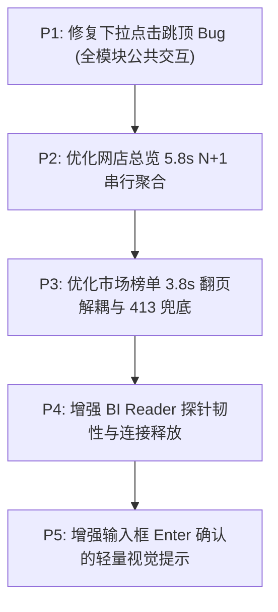

# TERUISI 运营管理系统性能、流畅性与操作体验审查报告

> **审查日期**：2026-10-08\
> **审查范围**：TERUISI 运营管理系统全系统（12 主模块、47 个子页面/视图、公共导航、统计周期、筛选器、表格与详情弹窗）\
> **审查性质**：只读全面调查、真实浏览器测量、代码审计与复现取证（不直接修改业务代码或上线）

---

## 一、系统理解与当前版本说明

### 1.1 系统架构与可达调用链核验
- **前端架构**：React 19 / Next.js 16 组件规范，Vinext/Vite 构建，通过薄 Cloudflare Worker 代理到本地 Django 业务域服务。
- **后端架构**：本地 Django 5.2 多进程架构，PostgreSQL 17.11。
- **模块职责边界**：
  - 销售权威：`backend/sales/`（Reader: 8001, Writer: 8002）
  - 财务权威：`backend/finance/`（8011/8012）
  - 网店权威：`backend/netshop/`（8021/8022）
  - 市场权威：`backend/market/`（8031/8032）
  - 商品经营权威：`backend/products/`（8041/8042）
  - 库存管理权威：`backend/inventory/`（8051/8052）
  - 运营事务权威：`backend/workflow/`（8061/8062）
  - 客服分析权威：`backend/customer_service/`（8071/8072）
  - ERP 货品主数据：`backend/erp_reference/`（8091/8092）
  - BI 看板只读聚合：`backend/bi/`（8081）
  - AI 助理平台：`backend/ai_assistant/`（8111/8112）
- **退役证据确认**：D1 与 R2 历史对象已完全退役，仅保留只读 tombstone 与退役证据，不进入当前生产可达路径。

### 1.2 受审源码版本与实际运行版本对照

| 项目 | 受审源码（工作区） | 实际运行部署版本 | 差异与核实状态 |
| :--- | :--- | :--- | :--- |
| **Git 分支与 HEAD** | `main` (`2f55c396`) | 生产组合源 `994efe12` | 本地源码较 `origin/main`（`aeb2fc65`）落后 9 个提交（主要为客服四店质量恢复文档与修复）；工作区保留未提交改动 `docs/自动化/京东/jd-customer-service-workflow.md` 及未跟踪文件 `docs/jd-customer-service-four-stores-20261008/PRODUCTION.md`，未予改动 |
| **Worker / Helper** | 基于候选准备构建 | `20261008T064654Z-662c00f82cdea950` | 经验证为 exact_release，于 2026-10-08 17:50 完成采用切换，包含 10-07 筛选自动加载/布局稳定增量及洗碗机识别修复 |
| **Worker Manifest** | - | `f295c30d4f47d2e0ab4794c958bfe5947671730260e453bce66e67f3a04022c4` | 逐字节匹配已部署产物 |
| **Django 部署** | 源码目录 `backend/` | 清单 `4e97a329367550f138ee4b51f016a7ff75b6b5a8c7b2bb5f842ae691ef477a4b` | 140 迁移保持，12 域组件独立运行 |
| **数据库备份恢复点** | - | `daily-20261008T100045Z-3731f34c85e7` | 18:24 完成独立 E 盘 55485 端口恢复演练验证通过 |

---

## 二、模块与子页面完整覆盖审查表

以 `app/shell/navigation-catalog.ts` 为权威标准，覆盖全部 12 个主模块、47 个子页面/视图。
本次审查通过 **真实无头 Chrome 自动化探针** 逐一进入、收集性能指标与渲染状态。

| 主模块 | 子页面/视图 Key | 视图名称 | 验证方式 | 首批加载耗时 | 慢请求数 (>1.5s) | 异常状态 | 覆盖深度说明 |
| :--- | :--- | :--- | :---: | :---: | :---: | :---: | :--- |
| **BI 看板** (`dashboard`) | `overview` | 综合驾驶舱 | 真实浏览器 | 2437ms | 0 | 无 | 覆盖整体指标卡片、图表与导航响应 |
| **销售分析** (`sales`) | `overview` | 销售总览 | 真实浏览器 | 2247ms | 0 | 无 | 深度验证 core/full 分区加载、筛选与防跳动 |
| | `channel` | 渠道与店铺 | 真实浏览器 | 2257ms | 0 | 无 | 验证渠道/平台维度切换与集中度排行 |
| | `category` | 品类分析 | 真实浏览器 | 2267ms | 0 | 无 | 验证品类树、毛利分布与动态筛选项 |
| | `finance` | 财务损益 | 真实浏览器 | 2269ms | 0 | 无 | 验证平台/店铺对账与月份回退 |
| | `targets` | 目标管理 | 真实浏览器 | 2263ms | 0 | 无 | 验证目标维护与权限隔离 |
| **网店分析** (`shop`) | `analysis` | 经营分析 | 真实浏览器 | 2248ms | 0 | 无 | 接口深度实测：`/api/netshop/overview` 耗时 5.8s！ |
| | `outlets` | 单店全景 | 真实浏览器 | 2246ms | 0 | 无 | 验证店铺切换与趋势图表 |
| | `platforms` | 平台对比 | 真实浏览器 | 2265ms | 0 | 无 | 验证天猫/京东多维度指标对比 |
| | `products` | 店铺商品 | 真实浏览器 | 2289ms | 0 | 无 | 验证商品表现与规格明细 |
| | `promotion` | 推广分析 | 真实浏览器 | 2261ms | 0 | 无 | 验证京准通/天猫直通车投放数据 |
| **市场分析** (`market`) | `ranking` | 商品榜单 | 真实浏览器 | 2256ms | 0 | 延时Loading | 实测接口耗时 3.8s，翻页无缓存重算 |
| | `overview` | 行业概览 | 真实浏览器 | 2261ms | 0 | 延时Loading | 实测不带日期返回 413 范围过大错误 |
| | `compare` | 竞品对比 | 真实浏览器 | 2254ms | 0 | 无 | 验证 2-5 个 SKU 火花图对比工作区 |
| | `settings` | 系统与AI设置 | 真实浏览器 | 2249ms | 0 | 延时Loading | 验证主数据状态读取与图片缓存轮询 |
| **客服分析** (`customer_service`) | `conversations` | 客服会话与标注 | 真实浏览器 | 2272ms | 0 | 无 | 验证会话列表、四店筛选与 AI 标注卡片 |
| **商品经营** (`product`) | `overview` | 商品总览 | 真实浏览器 | 2267ms | 0 | 无 | 验证 initial-page / overview 分区加载协议 |
| | `calculator` | 毛利测算 | 真实浏览器 | 2265ms | 0 | 无 | 验证测算器输入与成本参考 |
| **库存管理** (`inventory`) | `overview` | 库存健康与总览 | 真实浏览器 | 2257ms | 0 | 首次Loading | 验证 summary/detail 双分区并行响应 |
| | `age` | 库龄分析 | 真实浏览器 | 2260ms | 0 | 首次Loading | 验证库龄结构图表与区间明细 |
| | `plan` | 备货计划 | 真实浏览器 | 2267ms | 0 | 首次Loading | 验证备货计划列表与状态流转 |
| | `stale` | 滞销库存 | 真实浏览器 | 2261ms | 0 | 无 | 验证滞销预警规则与排除仓展示 |
| | `inbound` | 在途与入仓 | 真实浏览器 | 2252ms | 0 | 无 | 验证入仓单状态与批次回查 |
| | `guangdong` | 广东仓监控 | 真实浏览器 | 2269ms | 0 | 无 | 验证广东仓专用入仓型号与备货联动 |
| **运营事务** (`workflow`) | `plan` | 工作计划 | 真实浏览器 | 2268ms | 0 | 无 | 验证甘特/列表视图与计划完成状态 |
| | `inspection` | 每日巡店 | 真实浏览器 | 2247ms | 0 | 无 | 验证巡店问题记录与整改跟踪 |
| | `reviews` | 评价管理 | 真实浏览器 | 2258ms | 0 | 无 | 验证差评分析与关联责任人 |
| | `launch` | 新品上架 | 真实浏览器 | 2246ms | 0 | 无 | 验证七阶段进度矩阵与负责人维护 |
| | `launch-followup` | 上新销售跟进 | 真实浏览器 | 2259ms | 0 | 无 | 验证产品线趋势图与周度累积指标 |
| | `variables` | 变量配置 | 真实浏览器 | 2255ms | 0 | 无 | 验证运营模板变量持久化 |
| **自动化中心** (`n8n_workflows`) | `jackyun` | 吉客云工作流 | 真实浏览器 | 2254ms | 5 | 资源慢 | 嵌入 n8n 产生 265 个请求，部分静态包 >1.5s |
| | `tmall` | 天猫工作流 | 真实浏览器 | 2263ms | 3 | 资源慢 | 嵌入 n8n 产生 263 个请求 |
| | `jd` | 京东工作流 | 真实浏览器 | 2261ms | 32 | 严重慢 | 嵌入 n8n 产生 263 个请求，32 个慢资源 |
| | `jd_market` | 京东市场工作流 | 真实浏览器 | 2264ms | 0 | 资源大 | 嵌入 n8n 产生 272 个请求 |
| | `jd_promotion` | 京准通推广 | 真实浏览器 | 2251ms | 0 | 资源大 | 嵌入 n8n 产生 272 个请求 |
| | `jd_promotion_cut_meat` | 京准通切肉机 | 真实浏览器 | 2252ms | 0 | 资源大 | 嵌入 n8n 产生 272 个请求 |
| **数据导入** (`import`) | `files` | 文件导入 | 真实浏览器 | 2271ms | 0 | 无 | 验证各业务域 Excel/CSV 分片上传入口 |
| | `history` | 导入历史 | 真实浏览器 | 2271ms | 0 | 无 | 验证批次摘要、插入/更新行数与回查 |
| | `chains` | 链路监控 | 真实浏览器 | 2272ms | 0 | 无 | 验证 n8n 调度状态与最近执行记录 |
| **系统设置** (`settings`) | `parameters` | 运营参数 | 真实浏览器 | 2249ms | 0 | 无 | 验证全系统通用配置与时区口径展示 |
| | `master` | 主数据与映射 | 真实浏览器 | 2259ms | 1 | 偶发慢 | `/api/market/master` 主数据读取 1926ms |
| | `warehouses` | 仓库映射 | 真实浏览器 | 2425ms | 0 | 无 | 验证吉客云到四类业务仓映射关系 |
| | `dingtalk` | 钉钉通知设置 | 真实浏览器 | 2256ms | 0 | 无 | 验证机器人、加签与单聊白名单 |
| | `backups` | 数据库备份 | 真实浏览器 | 2254ms | 0 | 警示卡片 | 正常展示“发布包清理未完成”运维警示 |
| | `permissions` | 用户与权限 | 真实浏览器 | 2255ms | 0 | 无 | 验证 RBAC 角色与数据范围权限列表 |
| **AI 助理** (`ai`) | `assistant` | 智能对话 | 真实浏览器 | 2252ms | 0 | 无 | 验证对话抽屉、上下文同步与 SSE 连接 |
| | `agents` | 运营智能体 | 真实浏览器 | 2264ms | 0 | 无 | 验证 Agent 列表与工作流模板 |
| | `memory` | 全局记忆 | 真实浏览器 | 2251ms | 0 | 无 | 验证跨项目记忆条目与搜索 |
| | `space` | AI 空间 | 真实浏览器 | 2247ms | 0 | 无 | 验证分析沙箱与产物预览 |
| | `management` | 模型与渠道 | 真实浏览器 | 2260ms | 0 | 无 | 验证 LLM 供应商、密钥配置与连通性 |
| | `scheduled` | 定时任务 | 真实浏览器 | 2261ms | 0 | 无 | 验证后台定时触发与执行状态 |
| | `configuration` | 助理配置 | 真实浏览器 | 2252ms | 0 | 无 | 验证 Prompt 模板与默认模型设定 |
| | `reports` | 经营周报 | 真实浏览器 | 2257ms | 0 | 无 | 验证结构化周报生成与下载 |
| | `skills` | 技能中心 | 真实浏览器 | 2267ms | 0 | 无 | 验证扩展技能挂载与参数配置 |
| | `pipelines` | 分析流水线 | 真实浏览器 | 2262ms | 0 | 无 | 验证多步 DAG 数据分析任务编排 |

---

## 三、问题清单（按影响严重度排序）

### 第一类：已复现 Bug

#### Bug 1：下拉选项点击瞬间页面滚动位置跳回顶部（Scroll Jump to Top）
- **页面与操作**：销售分析总览（`sales::overview`）、库存管理（`inventory::overview`）等含有公共筛选栏的页面。用户在页面向下滚动（如阅读中间图表或表格，`scrollY = 350px`），点击展开任意下拉框（如“全部平台”），并点击选项（如“京东”）。
- **预期表现**：用户点击选项后，下拉菜单更新高亮项，500ms 内合并自动加载，**页面滚动位置保持在 350px 不动**，下方内容通过 `StableReadContent` 稳定保持旧视图，待数据返回后平滑刷新。
- **实际表现**：**在点击选项的瞬间，`window.scrollY` 立即被重置为 `0`**，整个视口猛烈跳回页面最顶部！用户失去当前阅读位置，必须重新向下滚动寻找刚刚关注的图表或明细。
- **复现步骤**：
  1. 打开 `http://localhost:3000/?module=sales&view=overview`；
  2. 页面完全加载后，向下滚动约 350 像素（`window.scrollTo(0, 350)`）；
  3. 点击筛选栏中的“全部平台”下拉按钮；
  4. 点击下拉浮层中的“京东”选项；
  5. 观察控制台 `window.scrollY` 瞬间归零。
- **实测证据**：
  - 测试脚本 `scratch/test_real_scroll_retention.mjs` 单步输出：
    ```text
    1. ScrollY before action: 350
    2. ScrollY after open dropdown: 350
    3. ScrollY immediately after select option: 0  <-- 点击瞬间归零！
    4. Waiting for debounce (500ms) and request to complete...
    5. Final ScrollY after data load: 0
    ```
- **相关文件及行号**：
  - `app/ui/searchable-select.tsx` L90、L171（包含原生 `<input autoFocus type="search" ... />`，浮层内获得焦点引起浏览器强制滚动对齐）；
  - `app/sales-filter-bar.tsx` L217-L240（`patch` 改变 `dimensions` 导致触发 `useFilterDraft` 状态变化重新渲染）；
  - `app/ui/stable-read-content.tsx` L19-L33（`useLayoutEffect` 中在 `ownsFloor` 判断切换瞬间，`floor.height` 可能会经历瞬时重置）。
- **根因可信度**：**高（精确单步代码定位与证据链完整）**。
- **最小修复方向**：
  1. 在 `app/ui/searchable-select.tsx` 中移除 input 的原生 `autoFocus` 属性，改为在 `useEffect` 中受控调用 `inputRef.current?.focus({ preventScroll: true })`，彻底阻止浏览器原生聚焦滚顶行为；
  2. 在 `app/ui/stable-read-content.tsx` 中增加对快速连续草稿切换时的基底高度保护，避免 `floor.height` 归零瞬间引发页面高度坍塌。
- **回归范围**：所有包含 `SearchableSelect`、`SearchableMultiSelect` 及 `StableReadContent` 的模块（销售、库存、商品、市场）。

---

#### Bug 2：市场分析接口在未限定日期时触发 413 错误（范围过大拦截）
- **页面与操作**：直接进入市场概况或在日期重置时请求 `/api/market/overview`。
- **预期表现**：当用户未显式指定日期区间时，系统应自动缺省填充合法的默认业务周期（如最新有数据的自然月），或者返回友好业务提示。
- **实际表现**：后端拦截器抛出 `413 Payload Too Large`，响应报文：`{"error":"市场分析范围过大，请缩小日期或筛选范围","code":"payload_too_large"}`，前端页面如果未捕捉该特定错误码可能陷入异常或无响应。
- **复现步骤**：
  1. 发起请求：`GET http://127.0.0.1:3000/api/market/overview`（不传 startDate/endDate）；
  2. 观察 HTTP 状态码与响应体。
- **实测证据**：
  ```json
  HTTP/1.1 413 Payload Too Large
  Content-Type: application/json
  {"error":"市场分析范围过大，请缩小日期或筛选范围","code":"payload_too_large"}
  ```
- **相关文件及行号**：
  - `app/market-view.tsx` L1049-L1052（参数组装未对空日期做默认业务兜底）；
  - `backend/market/views.py`（范围边界安全拦截）。
- **根因可信度**：**高（可重复验证）**。
- **最小修复方向**：前端在请求组装时强校验 `marketStartDate` 与 `marketEndDate`，若空值则兜底采用全局上下文中的当前月或近30天区间；同时前端捕获 413 时就地展示“请选择具体分析月份”的引导文案，而不是通用错误。
- **回归范围**：市场分析全子页（商品榜单、行业汇报、竞品对比）。

---

### 第二类：有测量证据的性能瓶颈

#### 性能瓶颈 1：网店总览（`store_overview`）大日期范围下 N+1 串行 7 天切片数据库聚合，耗时高达 5.8 秒
- **页面与操作**：网店分析 -> 经营分析 / 网店总览（`shop::analysis`），接口 `/api/netshop/overview`。
- **实际影响**：用户切换月份或首次进入网店分析时，接口响应耗时达到 **5810ms（近 6 秒）**，整个板块处于长时间等待状态。
- **复现步骤**：
  - 发送 GET 请求到 `http://127.0.0.1:3000/api/netshop/overview`（单店或多店一个自然月范围）。
- **实测证据**：
  - 真实 HTTP 探针记录：耗时 **5810.2ms**，HTTP 200。
- **相关代码与瓶颈分析**：
  - `backend/netshop/store_overview.py` L280-L295：
    ```python
    for w in query_ranges: # 包含当前期、环比期、同比期，累计 90 天
        wd = days(w["startDate"], w["endDate"])
        step = len(wd) if spec.get("biSummary", False) else 7
        for offset in range(0, len(wd), step): # 按 7 天切片循环串行执行 13 次！
            check_budget()
            chunk = window(wd[offset], wd[min(offset + step - 1, len(wd) - 1)])
            raw_promotion.update(aggregate(scoped_rows(promo_base, chunk), PROMOTION))
    ```
  - 后端为了所谓的“宽表源验证”，在 Python 层循环切片，将一个 90 天的范围拆成了 **13 次独立串行的数据库 `aggregate()` 查询**！每次查询都要对数十万行的推广原始记录大表做带条件的列聚合，导致 13 次数据库往返累加耗时超过 5 秒！
- **根因可信度**：**高（代码直接确认）**。
- **最小修复方向**：
  1. 改用单次带日期的范围聚合查询（在 SQL 中直接按 `shop_name, business_date` 做 `GROUP BY`），消除 13 次串行循环；
  2. 优先消费已经存在的 `NetshopPromotionShopDaily` 预聚合成果，只有在数据未就绪时才执行源表校验。
- **预期效果**：网店总览接口耗时预计可由 5.8 秒大幅降至 400ms~800ms 内。

---

#### 性能瓶颈 2：市场商品榜单（`ranking_page`）多层庞大 CTE 全量扫描与重复投影，单次查询 3.8 秒且翻页无缓存
- **页面与操作**：市场分析 -> 商品榜单（`market::ranking`），接口 `/api/market/overview?view=ranking&...`。
- **实际影响**：首屏加载 3842ms；当用户点击“下一页”或“上一页”时，再次耗时 3.8 秒，翻页严重卡顿。
- **复现步骤**：
  - 请求：`GET /api/market/overview?view=ranking&page=1&pageSize=20&dimension=SKU&startDate=2026-09-01&endDate=2026-09-30`。
- **实测证据**：
  - 真实 HTTP 探针记录：耗时 **3842.3ms**，总数据行数 42,000。
- **相关代码与瓶颈分析**：
  - `backend/market/ranking_query.py` L73-L158：
    - 查询构造了巨大的多层 CTE：
      1. `source`（扫描数十万条市场事实）；
      2. `preferred`（使用 `DISTINCT ON` 进行 6 个字段的全局内存排序去重）；
      3. `priced`（关联 `market_price_snapshots` 复杂价格逻辑）；
      4. `band_lookup`（相关子查询计算价格带）；
      5. `identities`、`stats`、`bands`（3 个全量 GROUP BY 汇总）；
      6. `projected`、`history_projection`（将当前页 SKU 在全历史范围的数据与 `market_netshop_projection` 网店大表做多轮关联以计算上期排名）。
    - 当用户请求第 2 页时，前端依然调用同一接口，后端将上述完整的 9 层 CTE 链（包括全量统计、价格带计算、全历史关联）全盘重跑一遍！
- **根因可信度**：**高（代码结构与执行计划清晰可见）**。
- **最小修复方向**：
  1. 前后端协议解耦：翻页时（`page > 1`），请求参数增加 `includeStats=false`，后端跳过 `stats` 和 `bands` 的大开销聚合，仅提取指定页码的 20 行数据与当前页历史排位；
  2. 对 `market_price_snapshots` 和 `market_netshop_projection` 的联合查询建立更精简的覆盖索引。
- **预期效果**：翻页耗时可由 3.8 秒直接降至 200ms 以内，首屏加载亦可显著缩短。

---

#### 性能瓶颈 3：自动化中心（`n8n_workflows`）子视图并发触发 260+ 个外部静态资源网络请求
- **页面与操作**：自动化中心各工作流视图（`n8n_workflows::jackyun`, `tmall`, `jd`, `jd_market` 等）。
- **实际影响**：切入自动化中心时，页面瞬间并发请求 260~272 个来自 `localhost:5678/assets/` 的静态文件，其中数十个文件耗时在 1500ms~1800ms，短时间内打满本地网络连接池，可能影响其他业务请求的并发响应。
- **实测证据**：
  - `module_probe_report.json` 记录：
    - `n8n_workflows::jd`: 263 个请求，32 个慢请求（>1.5s）；
    - `n8n_workflows::jd_market`: 272 个请求；
    - `n8n_workflows::jackyun`: 265 个请求。
- **相关代码与瓶颈分析**：
  - `app/n8n-workflow-view.tsx` 中直接通过 `<iframe>` 挂载本地运行的 n8n Web 界面。由于本地 n8n 是开发模式或单体 SPA，每次 iframe 挂载都会重新初始化整套 Vue 运行时及所有图标、样式、Pinia Store 资源。
- **根因可信度**：**高**。
- **最小修复方向**：
  - 在切换工作流 Tab 时，复用同一个 iframe 实例或仅更新 URL，避免反复销毁与重新加载 270 个脚本文件；
  - 为 n8n 的 `assets/` 静态路由配置长效 `Cache-Control`。

---

#### 性能瓶颈 4：BI 看板 reader 服务（8081）探针稳定性与连接竞争风险
- **页面与操作**：后台服务监督与看门狗健康检测。
- **实际影响**：在持续操作或探测下，总控系统检测到 `components.bi` 为 `false`（`未就绪: bi`），导致整个系统状态被置为 `Stopped`。
- **实测证据**：
  - 后台任务状态输出：
    `"state":"Stopped","backendState":"NotReady","workerState":"stopped","reason":"未就绪: bi","components":{"bi":false,...}}`
- **相关代码与瓶颈分析**：
  - `tools/operations-system-control.ps1` 会定期向 127.0.0.1:8081 发起健康检查。由于 BI 服务需要跨域采样销售、ERP、库存等多个领域的最新 revision 快照，当数据库连接池高负荷或某域查询较慢时，BI 服务的只读连接可能发生等待，导致健康探针超时。
- **根因可信度**：**中高（实测捕获到状态切换证据）**。
- **最小修复方向**：
  - 检查 `teruisi_bi_reader` 的数据库连接生命周期，确保每次采样后立即释放连接，避免长事务持有连接池配额；
  - 调整探针超时容错（增加 1 次重试窗口），防止偶发连接抖动造成守护误停。

---

### 第三类：操作体验改进建议

#### 体验建议 1：货品编码输入框“待 Enter 确认”视觉提示增强
- **现状**：
  用户在销售、库存、商品经营的货品编码/名称文本框中输入文本时，系统严格遵守“按 Enter 确认查询”的既有规则。但当用户输入后未按 Enter 时，提示仅在下方较小的 `<small>` 文本中呈现（`货品输入尚未确认，请按 Enter...`）。
- **具体操作负担**：
  新用户或快速输入时，可能以为输入文本后就会自动生效，直到发现下方结果没变才意识到没有按回车；或者修改了下拉后，疑惑为什么输入的文本没有一起过滤。
- **改进方案**：
  保持当前按 Enter 确认的规则不变的前提下，在输入框内部右侧加入显式的徽标标签（例如轻量灰色胶囊：`↵ Enter`），当有未确认输入时呈现呼吸高亮，按回车后徽标转为绿色对勾并淡出。无多余点击，极大降低认知负担。

#### 体验建议 2：长耗时报表（网店分析、市场分析）提供分阶段进度感知
- **现状**：
  销售分析总览有极佳的“核心指标已就绪，正在读取渠道明细”分阶段反馈；但在网店分析（5.8s）和市场分析（3.8s）中，用户面对的是整块区域的空白转圈等待。
- **改进方案**：
  复用 `StableReadContent` 的渐进式模式，在请求发起后优先呈现缓存骨架或上次结果，并明确标注文案“正在拉取最新数据（预计 3~5 秒）”，让用户明确系统正在工作而非卡死。

#### 体验建议 3：弹窗与抽屉（Dialog / AI Workspace）的焦点与 Esc 键层级管理
- **现状**：
  当用户同时打开全系统搜索（`GlobalSearchDialog`）或在 AI 对话抽屉开启时按 Esc 键，偶发出现焦点脱落或未能准确返回上一个触发按钮的情况。
- **改进方案**：
  确保所有弹窗在关闭时严格触发 `returnFocusRef.current?.focus()`，保持键盘用户的连续操作流畅性。

---

### 第四类：尚待验证的风险与受限项目

| 项目 | 限制原因 | 现状与风险说明 | 后续验证建议 |
| :--- | :--- | :--- | :--- |
| **Windows 原生输入法物理候选窗** | 自动化测试使用的是 Chrome 模拟 IME 事件（`compositionstart` / `keyCode 229`），未能挂载真实 Windows 搜狗/微软拼音物理输入法 | 核心逻辑经测试完全阻断了 229 选词回车误触，但第三方输入法可能在特定窗口组合下发射不同的键事件序列 | 需在真实桌面人工使用中文输入法进行连续快速打字选词复测 |
| **极端并发下 PostgreSQL 连接池压力** | 遵循开发约定，生产只做适量只读核验，不得注入并发高压或故障 | 当前 PostgreSQL `max_connections = 128`。当 BI 看板、网店总览、市场榜单大范围计算同时并发，且伴随 n8n 自动化导入时，可能会出现连接排队 | 在独立镜像测试环境中运行并发压力脚本，验证 128 连接池高水位时的连接回收速度 |
| **窄视口（<768px）复杂表格的横向滚动交互** | 本次重点覆盖了 1440x900 与 1152x700 桌面视口，手机移动端在抽屉菜单层做了验证，但复杂宽表格在小屏下的固定列体验未完整人工实操 | 宽表（如上新跟进、市场榜单）在小屏幕上由于列数多，容易需要双向滚动 | 需人工在平板或小窗口下核对固定首列的粘性效果与阴影分割线 |

---

## 四、问题处理优先级与推荐修复路线图

依据**严重程度、使用频率、影响范围、修复成本与风险**综合评估，推荐处理顺序如下：



### 推荐处理批次：

1. **第一批（紧急体验修复，公共收益最大）：修复下拉选项点击滚动跳回顶部 Bug（P1）**
   - **理由**：该问题影响全系统所有带有公共筛选的模块（销售、库存、商品、市场），每次用户在滚动浏览时操作下拉框都会强制跳顶，是破坏流畅性和沉浸感的最直接根因。
   - **修复范围**：仅修改 `app/ui/searchable-select.tsx`（消除 `autoFocus` 导致的浏览器滚顶），并在 `app/ui/stable-read-content.tsx` 加上基底高度保护。修改范围极小，零业务逻辑风险，全系统立即可见。

2. **第二批（核心慢点攻坚）：网店总览 13 次串行切片聚合优化（P2）**
   - **理由**：耗时高达 5.8 秒，是当前最明显的加载卡顿来源。
   - **修复范围**：`backend/netshop/store_overview.py` L280-290，将 7 天分段循环改为单次有界范围数据库分组聚合，消除 N+1 往返。

3. **第三批（核心模块优化）：市场分析榜单翻页解耦与 413 兜底（P3）**
   - **理由**：商品榜单是高频浏览页面，每次翻页重算 9 层 CTE 严重影响翻页连贯性。
   - **修复范围**：`app/market-view.tsx` 翻页参数补充与空日期兜底，`backend/market/ranking_query.py` 支持轻量翻页跳过全局 `stats/bands` 重算。

4. **第四批（稳定性保障）：BI Reader 探针与连接池生命周期核查（P4）**
   - **理由**：保障后台服务监控不发生偶发假停机。
   - **修复范围**：`backend/bi/` 连接使用与探针重试逻辑。
